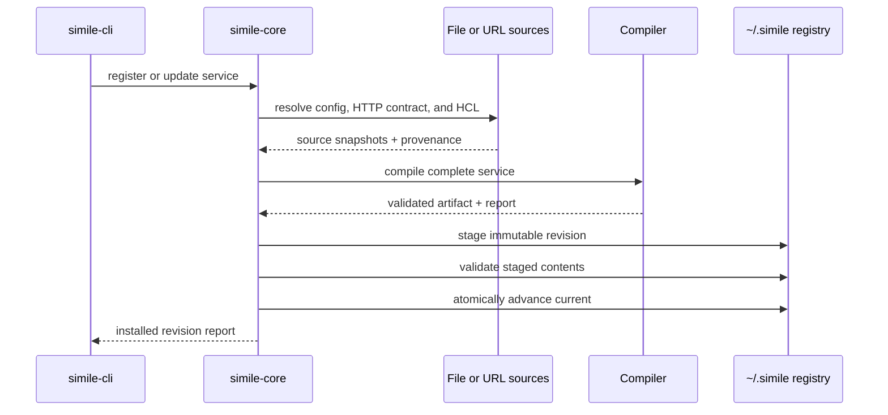
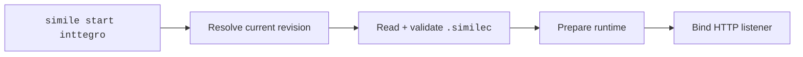

`simile-core` is the application boundary around the compiler, artifact reader, runtime, and server.
It coordinates units of work without absorbing their domain logic. `simile-cli` remains a thin
adapter that turns arguments into core requests and renders structured results.

## Register and update

A revision contains the service configuration snapshot, a versioned JSON manifest, and the
`.similec` artifact. Installation uses staging and rename before advancing a small `current` pointer,
so a failed compile or interrupted write cannot expose a partial service.

`simile update NAME` recompiles the stored configuration. Supplying `--config` replaces the config
source with a file or URL, resolves its provenance, compiles a complete new revision, and advances
`current` only after success. Older revisions remain immutable.

`simile remove NAME --confirm NAME` deletes the service's entire registry directory and its durable
service state database. Exact-name confirmation is mandatory. Removal first acquires the same
exclusive state lock used by the supervisor, so it refuses to unlink a running service's state.
The registry layout, standalone component state, and other named services are not changed.

## Start a named service

Starting by name never returns to the original contract URL or HCL path. It loads the selected
artifact, validates its envelope and internal indexes, prepares the runtime, and gives the artifact
to `simile-server`. This makes a registered service reproducible even if a remote specification
later changes or disappears.

## One-shot operations

The same application layer powers `simile run`. It resolves a specification or artifact, selects an
operation by method/path or `operationId`, optionally synthesizes a request, invokes the runtime,
and returns a structured report. Terminal color, verbosity, and pretty-printing stay in the CLI.

## Reporting records

Reporting is another application operation. `simile-core` resolves profile consent, verifies an
incident case against its exact artifact, records it under `~/.simile/reports`, checks for available
upgrades, and submits it to the destination captured with consent. The HTTP adapter supplies only a
sanitized candidate incident.

One-off reports use the same verifier and store. An explicit `--contact` authorizes that submission
without enabling future automatic reports. See [Report an issue](/issue-reporting).

## Ownership boundary

Core may coordinate source loading, compilation, registry transactions, and listener preparation.
It does not interpret OpenAPI, Smithy, TypeScript, or HCL, validate JSON Schema itself, encode CBOR, match HTTP routes,
or format terminal output. Keeping those responsibilities in their component crates makes every
application operation replaceable and testable.

For command-level behavior, see [Lifecycle](/service-lifecycle). For the bytes installed in
each revision, see [Compiled artifact](/compiled-artifact).
