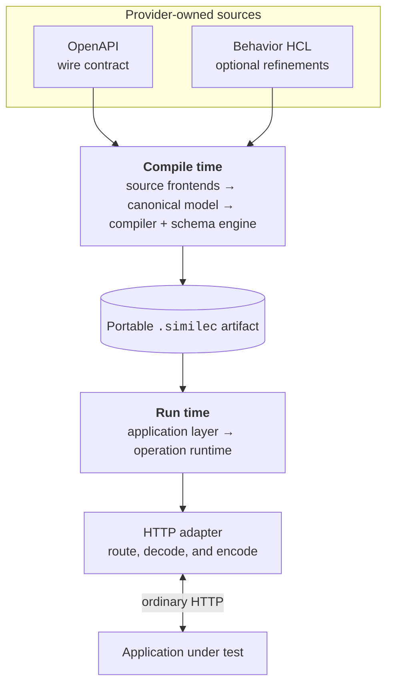
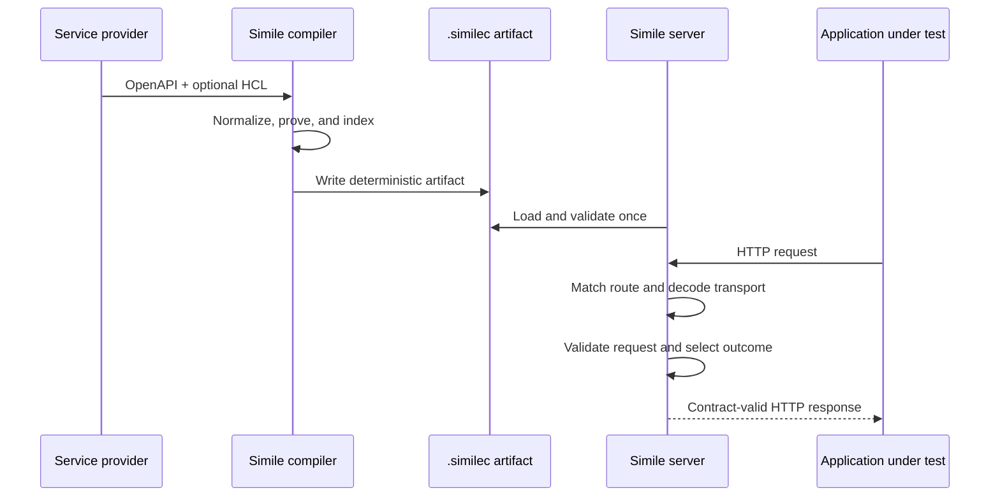

Simile has two halves. At **compile time**, it turns provider-owned OpenAPI and optional behavior
HCL into a portable `.similec` artifact. At **run time**, it loads that artifact and serves the
contract over HTTP. The source languages never leak into request handling.

The `.similec` artifact is the seam between the two halves. Compilation can perform expensive
parsing, reference resolution, cross-source checks, and schema indexing once. Execution then works
only with validated, indexed records and never needs the original OpenAPI or HCL.

## The architecture in one request

This separation lets the same compiled service power a one-shot CLI operation, a local HTTP server,
or a future host without making schema logic depend on any transport.

## Explore the components

| Area | Owns | Detailed page |
| --- | --- | --- |
| Sources and model | OpenAPI adaptation, HCL semantics, and the version-neutral service model | [Source model](/source-model) |
| Compilation | Cross-source coordination and lowering into executable records | [Compilation pipeline](/compilation-pipeline) |
| Schema engine | Validation, synthesis, explicit soundness constraints, and cautious inference | [Schema engine](/schema-engine) |
| Artifact | Deterministic CBOR encoding and the compile-time/run-time compatibility boundary | [Compiled artifact](/compiled-artifact) |
| Runtime | Protocol-neutral operation execution | [Operation execution](/operation-execution) |
| HTTP | Routing, wire limits, content negotiation, and error adaptation | [HTTP server](/http-server) |
| Application layer | Source loading, service registration, revisions, and process orchestration | [Application and registry](/application-registry) |

## Rules that preserve the boundaries

- OpenAPI is the source of truth for the public HTTP contract. HCL may refine observable behavior,
  but it cannot replace or contradict that contract.
- `simile-compiler` is the only layer allowed to combine source languages.
- `.similec` is the only contract between compilation and execution. A registered service starts
  from its artifact rather than refetching its sources.
- `simile-runtime` is protocol-neutral. HTTP routing and response writing belong to
  `simile-server`; files, URLs, registry paths, and terminal output belong above both.
- Explicit `x-simile-constraints` participate in proof and construction. Heuristics may improve
  generated values, but they never decide whether an incoming payload is valid.
- Published behavior describes what an integrator can observe, not private production decision
  trees or provider-specific infrastructure.

See [Current boundaries](/current-boundaries) for the fidelity Simile deliberately does not claim
yet.
