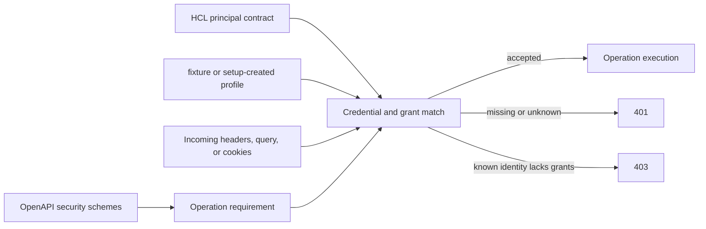

Authentication begins in the API contract. OpenAPI names each mechanism, tells clients where to
present credentials, and attaches security requirements to operations. Simile preserves that
structure and lets the service author provide local test identities in HCL. A service can also
issue credentials into [setup-created profiles](/service-profiles), which is the natural path when its
real onboarding flow creates an application, account, or project.



## Publish the security contract

```yaml
components:
  securitySchemes:
    merchantKey:
      type: apiKey
      in: header
      name: X-Merchant-Key
    merchantOAuth:
      type: oauth2
      flows: {}

paths:
  /orders:
    post:
      operationId: createOrder
      security:
        - merchantOAuth: [orders:write]
        - merchantKey: []
```

The two array entries are alternatives. A bearer credential with `orders:write` can satisfy the
first entry, while the API key can satisfy the second. Schemes inside one entry compose with
logical AND. This follows OpenAPI's native OR-of-AND model and avoids a second security language.

An operation-level `security: []` makes that operation public even when the document declares
global security.

## Declare principal contracts and fixture profiles

[Principals](/principals) explains the caller model and grant ownership in full. The declaration
below combines that contract with two concrete fixture profiles.

```hcl
principal "merchant_application" {
  description = "A local merchant integration with order write access."
  credential "merchantOAuth" {
    grants = ["orders:write"]
  }

  credential "merchantKey" {}
}

profile "merchant_app" {
  principal = principal.merchant_application
  credential "merchantOAuth" { value = "sim_test_merchant" }
}

profile "revoked_key" {
  description = "A key retained for revocation handling tests."
  principal   = principal.merchant_application
  status      = "revoked"
  credential "merchantKey" { value = "sim_test_revoked" }
}
```

The principal's credential label refers to an OpenAPI security-scheme name. `grants` describes the
scopes available through that credential. A profile references one principal and fills its
credential slots with synthetic values. The compiler checks that every value fits the scheme:

- API keys, bearer tokens, OAuth 2.0, and OpenID Connect use `value`.
- HTTP Basic uses `username` and `password`.
- profile `status` accepts `active`, `revoked`, or `expired` and defaults to `active`.
- principal credential `grants` contains the scopes profiles of that principal may exercise.

Use recognizable local fixtures such as `sim_test_*`. The compiled artifact contains those fixture
values so the emulator can compare requests. Keep production credentials out of configuration,
artifacts, examples, and source control. `simile describe service` lists principal contracts and
fixture profiles while withholding credential values.

## Send authenticated requests

```console
$ curl http://127.0.0.1:4242/orders \
    -H 'Authorization: Bearer sim_test_merchant' \
    -H 'Content-Type: application/json' \
    --data '{"customer_id":"cu_test"}'
```

Authentication runs after route matching and before parameter or body validation. This ordering
lets a protected endpoint reject an unknown caller without revealing contract details from deeper
validation.

| Condition | Result |
| --- | --- |
| no declared security requirement | operation remains public |
| a complete alternative matches one active profile | operation executes |
| credential is missing, unknown, revoked, or expired | `401 authentication_required` |
| credential identifies an active principal without the required grants | `403 permission_denied` |

Provider-authored `protocol_error` mappings can replace Simile's fallback envelopes for
`authentication_required` and `permission_denied`.

## Authenticate with a setup-created profile

An `issue` declaration fills one credential slot from the principal contract:

```hcl
issue "access_token" {
  from       = response.access_token
  credential = "merchantOAuth"
  sensitive  = true
}
```

After `simile setup`, the running service matches that value using the same security rules as a
fixture profile. Multiple active profiles remain valid together. The principal and profile follow the
request into committed effects and deferred webhook delivery so per-application destinations and
signing secrets remain isolated.

## Current boundary

API keys in headers, query strings, and cookies are supported, together with HTTP Basic, HTTP
Bearer, OAuth 2.0 bearer tokens, and OpenID Connect bearer tokens. Mutual TLS appears in compiled
contracts. The fidelity audit marks each affected operation because the listener currently has no
verified client-certificate input.

Continue with [Configuration](/service-configuration) for composition, [Fidelity audit](/fidelity-audit)
for coverage checks, or [Current boundaries](/current-boundaries) for the full support map.
