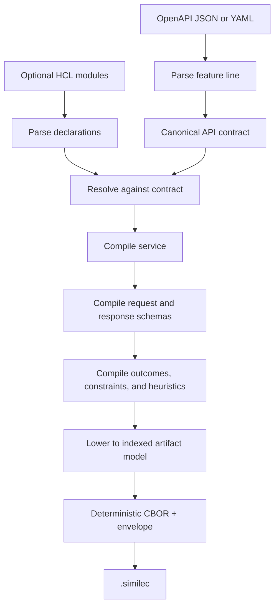

Simile compiles provider-authored text into a source-independent runtime artifact. Compilation is
where ambiguity is resolved: references are linked, schemas become executable graphs, outcomes are
checked, and constraints become typed proof rules.

## 1. Normalize OpenAPI

`simile-openapi` accepts JSON or YAML and dispatches by the OpenAPI feature line. Simile supports
the 3.0, 3.1, and 3.2 lines while preserving the exact patch version for diagnostics and
reproducibility.

The adapter produces a canonical contract containing service metadata, stable `METHOD /path`
operation keys, optional `operationId` values, request bodies, responses, tags, examples, and
schema fragments. Source-format details do not escape into the canonical model.

## 2. Parse and resolve HCL

`simile-hcl` first parses syntax without consulting OpenAPI. A semantic pass then resolves every
behavior against the canonical contract. Collection before resolution makes module order
irrelevant.

The semantic compiler rejects:

- duplicate declarations;
- behavior that names an unknown `operationId`;
- a response status absent from that operation;
- unknown async operations or resources;
- provider-specific resource kinds; and
- scenarios that select unknown outcomes.

This two-phase design keeps syntax errors separate from cross-source meaning.

## 3. Merge one compiled service

`simile-compiler` is the only layer allowed to combine source languages. Each HTTP operation gets
an origin:

- `open_api` when the contract supplies its complete current behavior;
- `hcl` when an optional overlay refines it.

The compiler builds a named outcome catalog from bodyless responses, OpenAPI examples, schema-only
responses, error sets, and operation outcomes. Provider-authored bodies are later checked against
the selected OpenAPI response schema.

## 4. Compile executable schemas

`simile-schema` lowers the supported JSON Schema subset into one indexed graph catalog. Local
component references become graph edges, recursive schemas remain recursive, and request and
response direction are distinct: `readOnly` fields leave the request graph; `writeOnly` fields
leave the response graph.

At this stage Simile also compiles:

- `x-simile-constraints` into typed proof and construction records; and
- provider-neutral generation heuristics into evidence-bearing repair plans.

Unsupported or impossible explicit constraints fail compilation. A heuristic is optional and can
never become an incoming-request validation rule.

## 5. Lower and encode

`simile-artifact` replaces names with indexes into sorted tables, orders all map-backed records,
and encodes the payload as deterministic CBOR. A fixed envelope records the format version,
payload length, and SHA-256 integrity digest.

The decoder validates the envelope and every internal index before returning an `Artifact`. This
means the runtime receives linked, checked records rather than fallible source syntax.

## Why compilation is a hard boundary

Moving work out of the request path has three benefits:

1. **Failure is early.** A bad definition cannot start a service and fail only when an operation is
   reached.
2. **Runtime is smaller.** It does not need YAML, HCL, JSON Schema source traversal, or unresolved
   strings.
3. **Execution is reproducible.** A registered service runs the validated artifact revision even
   if its original URL or local source later changes.

Return to the [architecture overview](/architecture), inspect the source frontends in
[Source model](/source-model), or continue to the [Compiled artifact](/compiled-artifact) wire
format.
