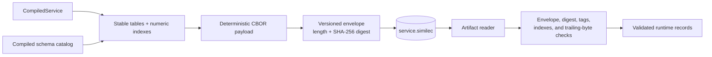

`.similec` is Simile's runtime distribution format. OpenAPI, Smithy, semantic TypeScript, and HCL
remain provider-authored and reviewable source formats; the runtime never needs to parse them on
startup.

The split is comparable to source code and an executable. Contract sources and HCL optimize for
authoring, review, and diagnostics. `.similec` optimizes for linked references, compact storage,
fast loading, and a clear compatibility boundary.

## Why not store normalized JSON

JSON would keep repeating field names and string references, and it would still require the
runtime to resolve many relationships after loading. Simile instead builds sorted tables and
replaces cross-record names with numeric indexes before encoding deterministic CBOR. The runtime
loads a graph that has already been linked and validated.

## Envelope version 16

Every artifact begins with a fixed 52-byte envelope:

| Offset | Size | Value |
| ---: | ---: | --- |
| 0 | 8 | ASCII `SIMILEC` followed by NUL |
| 8 | 2 | unsigned big-endian format version |
| 10 | 2 | unsigned big-endian flags; zero in version 16 |
| 12 | 8 | unsigned big-endian payload length |
| 20 | 32 | SHA-256 digest of the payload |
| 52 | variable | deterministic CBOR payload |

Readers must reject an unknown format version or non-zero flags. They must also reject a truncated
payload, trailing bytes, a digest mismatch, unknown record tags, and every out-of-range internal
index. These checks happen before runtime execution.

## Payload model

The payload is an ordered CBOR array rather than a serialized Rust struct map. Version 16 contains:

1. compiler version string identifier;
2. a sorted and deduplicated string table;
3. service metadata;
4. operations in stable operation-key order;
5. an indexed value arena used by response definitions, exact outcome bodies, and predicates;
6. resources in stable resource-reference order;
7. asynchronous operations in stable name order;
8. typed synchronous effects in stable name order; and
9. one shared request/response/parameter schema catalog.

Strings, value nodes, resources, and asynchronous operations are referenced with unsigned numeric
identifiers. Async-operation records point directly to their abstract resources. Effect records
link operation IDs to synchronous actions and named async units, while each action retains only a
typed resource command and a compact request/response value template.

Service metadata also carries the provider-neutral protocol-error table, opaque scenario
selections, environmental faults, bounded stochastic fault profiles, and a sorted public
description catalogue. Description records identify a semantic kind, optional parent, name, and
text. They let `simile describe` explain the service from the artifact without reopening HCL and
never participate in execution. Each operation carries a named outcome catalog with exact status,
optional media type and body, fidelity provenance, and public request predicates. Scenario records
map an operation key to one of those names and may map an operation to a declared environmental
fault; they never carry the private production decision that selected an outcome.

Fault records contain a typed phase and action. Profile records contain probability in integer
parts per million, linked fault indexes, linked operation indexes, repetition bounds, and an
optional seed. The runtime never reparses HCL or resolves profile names through source documents.

Each operation embeds compact parameter records, a request-body plan, and a body plan for every
response that declares content. Parameter records retain location, requiredness, style,
explosion/reserved flags, and an optional compiled schema root. Body plans contain declared media
types, schema root identifiers, and optional declared media
examples. Those roots point into the shared catalog, where component schemas are compiled once per
request/response direction and recursive references remain graph edges. Direction matters:
`readOnly` properties are omitted from request graphs and `writeOnly` properties are omitted from
response graphs. The catalog also contains compact schema example and default hints, plus explicit
OpenAPI `format` annotations used by seeded synthesis. OpenAPI schema description prose is
deliberately not interpreted as schema metadata. The runtime therefore validates requests and synthesizes requests
or responses without parsing OpenAPI, interpreting arbitrary source JSON, or copying common
schemas into every operation. String patterns are compiled into the schema graph and therefore
participate in validation and synthesis without reparsing OpenAPI.

Before encoding, provider-authored outcome bodies are checked against their selected contract
response schema. The public-export audit rejects explicit private implementation markers. This
audit is a guardrail; the provider remains responsible for reviewing all published values.

Recognized `x-simile-constraints` declarations are compiled into typed relationship records in the
same schema graph. Source extension objects are not shipped as arbitrary JSON. Artifact validation
rejects relationship selectors, predicates, witnesses, expressions, lifecycle plans, or comparison
kinds that do not match the embedded graph. Version 16 carries ordering, relative-bound,
implication, equality, equation, aggregate, distinct-selector, scalar-set, template, and lifecycle
records; the runtime does not reparse their source constraint syntax.

Response media plans may additionally carry a compiled `x-simile-from-request` relation. Its
bindings, derivations, guarded lifecycle rules, and omission rules reference the shared request and
response schema graph by validated identifiers. This is the proof material that distinguishes a
merely schema-valid response from one proven reachable from the submitted request.

Version 16 also carries typed provider-neutral generation plans. Every plan records a stable rule
identifier, confidence, source-field evidence, and a typed repair. The runtime consumes those
plans without re-running name inference. Provider-specific profiles are not part of this version.

Response-definition JSON retained from an OpenAPI source is lowered into tagged value nodes: null,
boolean, signed integer, unsigned integer, floating point, string identifier, child-node array, or
sorted object fields. Schema and media synthesis hints are encoded as CBOR values inside their
catalog records. The original JSON text is never stored in the artifact.

## Determinism and compatibility

String collection and every map-backed record set are ordered before encoding. CBOR records use
arrays and integer tags, so field names are not repeated. Given the same `CompiledService`, the
encoder must produce byte-identical output; this is covered by tests.

The envelope version is the compatibility boundary. Adding optional source syntax does not require
a format change when it lowers into existing records. A change that alters record meaning or order
requires a new format version and an explicit reader policy. Rust type layout, crate versions, and
Serde defaults are not compatibility promises.

The payload digest protects integrity and enables content-addressed caching. It is not a signature
and does not establish who published an artifact. Artifact signing and provider trust policy belong
to a later distribution layer.

See [Compilation pipeline](/compilation-pipeline) for how the artifact is produced and
[Operation execution](/operation-execution) for how the runtime consumes it.
