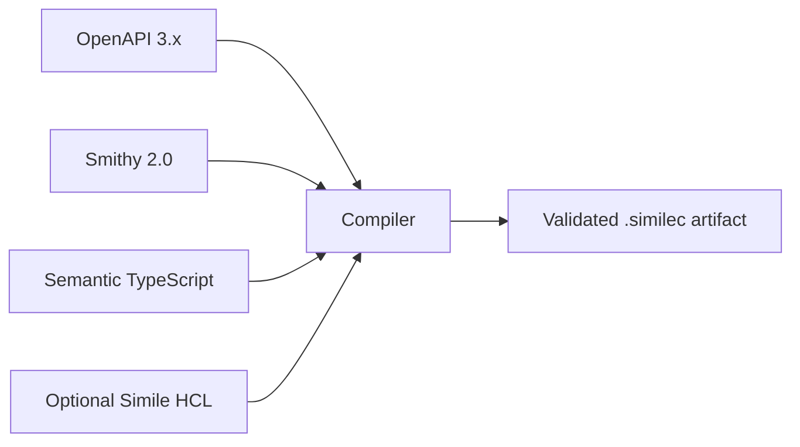

Every Simile service has one complete HTTP contract and may load optional HCL modules.
The contract can be OpenAPI, Smithy, or semantic TypeScript. All three are first-class inputs to the
same compiler, schema engine, runtime, and `.similec` artifact.



## Choose one contract language

| Source | Choose it when | Simile reads |
| --- | --- | --- |
| [OpenAPI](/openapi-and-hcl) | HTTP tooling and broad ecosystem compatibility are primary. | One OpenAPI 3.0, 3.1, or 3.2 JSON/YAML document. |
| [Smithy](/smithy-contracts) | A typed service model, traits, mixins, and model evolution are primary. | One standalone Smithy 2.0 IDL document. |
| [Semantic TypeScript](/typescript-contracts) | Consumers already exchange declarations and need payload relationships expressed in the type system. | One declarations-only entrypoint, its relative imports, or a declaration directory. |

The selected source is authoritative. Do not publish one format as the contract while requiring
Simile to consult another format for missing routes, payloads, or relationships. A provider can
generate several public representations, but each representation must compile independently when
it is offered to consumers.

## What the contract owns

The selected contract owns:

- HTTP methods, paths, parameters, request bodies, and content types;
- success and error statuses, headers, content types, and payloads;
- operation identifiers and public grouping metadata;
- provider-authored examples;
- public cross-field soundness relationships; and
- public request-to-response construction relationships.

Simile rejects a contract it cannot normalize into one coherent operation model. Compilation is the
boundary: the runtime executes the compiled artifact and does not reopen the source files.

## What HCL owns

HCL is optional and additive. It can select a response already declared by the contract, publish
exact named outcomes, define opaque test scenarios, map protocol errors, describe portable
dependencies, declare observable effects or asynchronous work, and resolve stored public
references needed to construct a response.

HCL cannot add a route, replace a request or response schema, invent a status, or weaken the
contract. It targets operations by stable `operationId`, so every operation referenced by HCL must
publish one.

```hcl
behavior "createOrder" {
  response { status = 201 }
}

scenario "payment_declined" {
  select "createPayment" {
    outcome = "card_declined"
  }
}
```

Use only public request values in predicates. When a private production decision leads to a public
result, expose an opaque scenario that selects the result instead of reproducing the private rule.

## Configure the source

A `Simfile` selects exactly one contract block:

```hcl
service "orders" {
  listen { port = 4242 }
  openapi { path = "./orders.yaml" }
}
```

```hcl
service "orders" {
  listen { port = 4242 }
  smithy { path = "./orders.smithy" }
}
```

```hcl
service "orders" {
  listen { port = 4242 }
  typescript { path = "./typescript/commerce.d.ts" }
}
```

The block may use `url` instead of `path`. A remotely loaded TypeScript contract must be a
self-contained declaration document because relative imports cannot be fetched as a package.
Smithy currently compiles one standalone source document. Local TypeScript entrypoints resolve
relative declaration imports recursively.

## Validate the same way

All formats use the same commands after authoring:

```bash
simile compile ./orders.yaml --artifact ./orders.similec
simile compile ./orders.smithy --artifact ./orders.similec
simile compile ./typescript/commerce.d.ts --artifact ./orders.similec
```

```bash
simile run ./orders.smithy --operation-id createOrder
simile audit ./orders.similec --strict
```

Successful compilation proves that the chosen source is self-contained enough for Simile, all
referenced operations and schemas resolve, provider-authored relationships are compatible, and
optional HCL agrees with the contract. It does not prove production latency, private decisions, or
undocumented behavior.

Continue with [OpenAPI](/openapi-and-hcl), [Smithy](/smithy-contracts), or
[semantic TypeScript](/typescript-contracts), then use [Configuration](/service-configuration) to
compose the runnable service.
