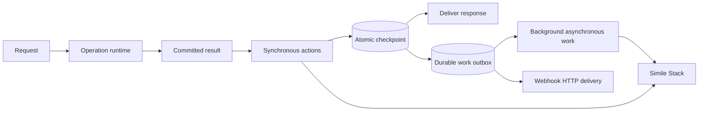

An HTTP result and its consequences are different things. `behavior` selects the public result;
`effect` attaches the state changes and follow-up work that become true when that result commits.
This separation keeps a provider definition reviewable and prevents background mechanics from
changing response selection by accident.



## Declare backends

Backends describe the supporting systems the emulator provides:

```hcl
backend "db" "orders" {}
backend "event_bus" "commerce" {}
backend "mail" "receipts" {}
```

The declaration exposes the capability class and local name. Production products, private table
names, credentials, and topology stay outside the public service definition. Supported kinds are
`cache`, `db`, `event_bus`, `http`, `mail`, `object_store`, `queue`, and `scheduler`.

## Define reusable background work

An `async` block is a named unit whose actions must not contribute to immediate response latency:

```hcl
async "publish_order" {
  description = "Publish the committed order for downstream consumers."

  action "event_bus.commerce" "publish" {
    topic = "orders.created"
    body  = response.order
  }
}
```

The action language is deliberately small. Arguments may use literals and public values projected
from the validated request or committed response. It is not a general-purpose expression language
and cannot call production systems during compilation.

## Attach consequences to operations

```hcl
effect "commit_order" {
  description = "Persist an order and announce it in the background."
  operations  = ["createOrder"]

  action "db.orders" "put" {
    collection = "orders"
    key        = response.order.id
    value      = response.order
  }

  async = ["publish_order"]

  emit = {
    "order.created" = response.order
  }
}
```

The compiler resolves operation IDs, backend references, action names, and required arguments. It
lowers them into typed artifact records. At runtime the service supervisor:

1. validates the request and commits one public outcome;
2. renders synchronous action arguments from that committed request and response;
3. applies the synchronous unit transactionally and checkpoints durable Stack state;
4. publishes schema-checked webhook occurrences and named asynchronous units to the durable outbox; and
5. allows HTTP response delivery to proceed while workers lease, retry, and acknowledge that work.

If a synchronous action or checkpoint fails, the Stack rolls back to its prior snapshot and the
response is not delivered as though the effect succeeded. Idempotent operation replay does not
repeat an already committed effect.

Webhook occurrence planning belongs to the same effect because it is another public consequence of
commit. The outbound wire contract still belongs in OpenAPI. See
[Webhook delivery](/webhook-delivery) for compact multi-webhook emission, causal edges, and
service-wide ordering policy.

Request and response projections also define when an effect applies. An action that reads
`response.order.id` is rendered only for outcomes that contain that value; a provider error or an
accepted-without-entity outcome therefore does not accidentally run the write or turn the public
outcome into an execution failure.

## Convention inference

When a service declares exactly one database, a `POST`, `PUT`, or `PATCH` operation has a stable
`operationId`, and one successful response contains exactly one identifiable entity, Simile can
infer the ordinary `db.put` action. The collection name comes from the semantic route segment and
the key comes from the response entity's `id`.

Inference stops at ambiguity. Multiple databases, multiple candidate entities, missing IDs, or an
authored effect require the provider to say what happens. Run [`simile audit`](/fidelity-audit) to
see which actions were authored, inferred, or missing.

## Causality and inspection

Every Stack command records a payload-free journal entry with its operation, causal parent,
correlation identifier, resource, action, time, and outcome. Stored values are never included in
the default journal view. Operators must explicitly opt in with `simile state SERVICE --values`.

See [State inspection](/state-inspection), [Simile Stack](/simile-stack), and the
[HCL language specification](/hcl-language-specification) for the complete forms. Read
[Durable work](/durable-work) for checkpoint, lease, retry, and restart semantics.
