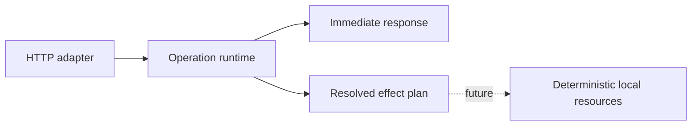

Many operations do work after the immediate HTTP response. Simile represents that work explicitly
instead of pretending the response is the entire operation. The provider declares an abstract
resource, names an async operation that uses it, and attaches that operation to an HTTP behavior.

```hcl
resource "db" "orders" {}
resource "event_bus" "commerce" {}
resource "mail" "receipts" {}

async "publish_order" {
  uses = [
    "db.orders",
    "event_bus.commerce",
    "mail.receipts",
  ]
}

behavior "createOrder" {
  response { status = 201 }
  trigger "publish_order" {}
}
```

## Why resources are abstract

The portable definition says that order creation needs database-like state, an event bus, and mail.
It does not say PostgreSQL, Kafka, or SES. Production vendor choices are neither necessary for
local emulation nor safe to treat as part of a public behavioral contract.

Supported resource kinds are:

- `cache`
- `db`
- `event_bus`
- `http`
- `mail`
- `object_store`
- `queue`
- `scheduler`

The compiler rejects any other kind and rejects references to undeclared resources.

## What the runtime does today

After request validation and response synthesis succeed, the runtime returns a plan containing the
triggered async operation and its resolved resource references:

```json
{
  "name": "publish_order",
  "resources": ["db.orders", "event_bus.commerce", "mail.receipts"]
}
```

This is a declaration of intended work, not evidence that the work ran. `simile run --verbose`
shows the plan, and the protocol-neutral runtime exposes it to adapters. The HTTP server does not
yet dispatch resource implementations, persist their state, advance delayed work, or expose an
effect history.

## Why planning comes before execution

Planning creates one success boundary. If request validation or response synthesis fails, no effect
plan is returned. A future executor can accept only completed operation outcomes and can record,
retry, or advance effects without reparsing HCL.

It also preserves architectural separation:



## What not to encode

Do not publish credentials, private table names, vendor topology, security thresholds, or an
internal decision tree. A resource declaration should identify the externally relevant capability
needed for local behavior. Private production decisions belong behind named public outcomes or
opaque scenarios.

Read [Current boundaries](/current-boundaries) before writing tests that assume an effect has
executed. Read [OpenAPI and HCL](/openapi-and-hcl) for the source ownership rules.
