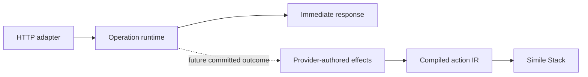

Many operations do work after the immediate HTTP response. Simile can already name that work and
its abstract dependencies without exposing production infrastructure. It does not yet attach the
work to an HTTP operation; that responsibility belongs to the forthcoming effect model.

```hcl
resource "db" "orders" {}
resource "event_bus" "commerce" {}
resource "mail" "receipts" {}

async "publish_order" {
  uses = [
    "db.orders",
    "event_bus.commerce",
    "mail.receipts",
  ]
}
```

## Why resources are abstract

The portable definition says that `publish_order` may use database-like state, an event bus, and
mail. It does not say PostgreSQL, Kafka, or SES. Production vendor choices are neither necessary
for local emulation nor safe to treat as part of a public behavioral contract.

Supported resource kinds are:

- `cache`
- `db`
- `event_bus`
- `http`
- `mail`
- `object_store`
- `queue`
- `scheduler`

The compiler rejects any other kind and rejects references to undeclared resources.

## What the operation runtime does today

The compiler validates every `uses` reference, retains resources and async declarations in the
artifact, and exposes them through `simile describe service`. The operation runtime does not return
an async plan. A declaration is service vocabulary, not an operation attachment and not evidence
that background work ran.

The former `trigger` block under `behavior` has been removed. A behavior selects an HTTP result; it
is not the right owner for state changes or follow-up work.

## What Simile Stack adds

[Simile Stack](/simile-stack) now implements each supported abstract resource as a deterministic,
serializable engine and local component process. Stack provides one typed command protocol, a
shared logical-time model, reset and snapshots, idempotent command replay, and a payload-free causal
journal.

The operation runtime does not yet dispatch those commands. `uses = ["queue.orders"]` proves that
an async operation may use the queue; it does not say which message to publish. Simile will not
invent that payload. A provider-authored action model must compile the intended state mutations and
effects into Stack commands before `simile start` can execute them.

## Where effects will fit

An effect will be a self-contained provider-authored attachment: it will select operations, define
state or background actions, and run only after the operation result is committed. That keeps HTTP
result selection in `behavior` and consequence execution in `effect`.

This preserves architectural separation:



## What not to encode

Do not publish credentials, private table names, vendor topology, security thresholds, or an
internal decision tree. A resource declaration should identify the externally relevant capability
needed for local behavior. Private production decisions belong behind named public outcomes or
opaque scenarios.

Read [Current boundaries](/current-boundaries) before writing tests that assume an effect exists or
has executed, [Simile Stack](/simile-stack) for the resource architecture, and
[OpenAPI and HCL](/openapi-and-hcl) for the source ownership rules.
