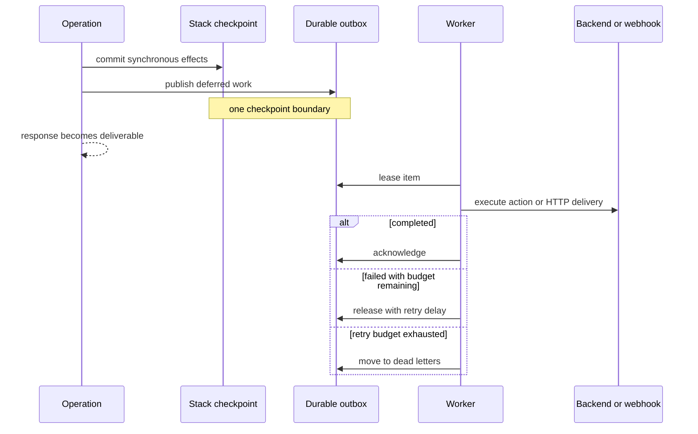

An operation may finish before every consequence completes. Simile represents those consequences
as durable work so response latency, crash recovery, and retries have explicit semantics.



## Define one asynchronous unit

```hcl
backend "event_bus" "commerce" {}

async "publish_order" {
  description = "Publish the committed order for downstream consumers."

  action "event_bus.commerce" "publish" {
    topic = "orders.created"
    body  = response.order
  }
}

effect "commit_order" {
  operations = ["createOrder"]
  async      = ["publish_order"]
}
```

The effect attaches `publish_order` to a committed operation result. Its rendered commands enter
the outbox in the same durable checkpoint as synchronous state. A process stopping immediately
after the commit leaves the work available to the next process.

## Lease and retry semantics

The worker leases available items with a visibility timeout. An unacknowledged lease becomes
available again, which covers process termination and lost worker ownership. Successful execution
acknowledges the item. Failed execution uses exponential retry delays of 2, 4, 8, 16, and up to 60
seconds. The default budget is five attempts. Waiting for a hard webhook prerequisite releases the
lease without consuming an attempt; retry budgets measure execution failures rather than queue
traffic.

Webhook completion becomes a durable causal marker in the same checkpoint that acknowledges its
outbox item. A dependent occurrence waits for every named prerequisite marker. A failed
prerequisite moves its dependent work to dead letters, preserving the declared causal promise
across delays, retries, and process restarts.

Exhausted work moves to the service's dead-letter queue with its typed payload, operation, name,
and attempt count intact. The service library exposes inspection and explicit redelivery primitives.
An operator-facing CLI for selecting and redelivering one dead letter remains a future interface;
the fidelity audit and current-boundaries page keep that limitation visible.

## One mechanism for async work and webhooks

Named async units and outbound webhook occurrences share the durable work substrate. Their
execution remains typed:

- async units carry compiled Stack commands;
- webhook items carry the resolved target, method, content type, body, delay, causal dependencies,
  correlation identity, and retry budget.

This shared mechanism gives both forms the same checkpoint, lease, retry, restart, and dead-letter
semantics while preserving their different executors.

## Persistence and identity

Registered services store the checkpoint at:

```text
$SIMILE_HOME/state/services/SERVICE.redb
```

The database identity includes the service and compiled artifact digest. Simile refuses to restore
state into an incompatible artifact. The checkpoint contains Stack resources, replay records,
causal journal, counters, clock state, outbox, and dead letters.

Continue with [Dependencies and effects](/dependencies-and-effects),
[Webhook delivery](/webhook-delivery), or [Stack persistence](/stack-persistence).
