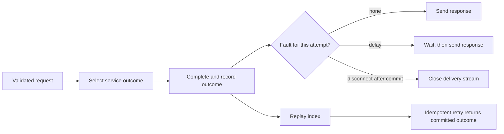

Faults change **how** a completed service result reaches the caller. They do not change **which**
result the service produces. That distinction keeps Simile useful for integration tests:

- a declined payment, invalid parameter, or forbidden state is a deterministic outcome selected by
  a public request condition or an opaque scenario;
- high latency and a lost connection are environmental faults applied to an operation attempt; and
- asynchronous work remains a declared effect, not a fault.

Simile models those concepts separately all the way from HCL to the HTTP adapter. A stochastic
profile can therefore disrupt delivery, but it cannot invent a bad payment method when the caller
sent a valid one.



## Declare faults

The first fault vocabulary is intentionally small:

```hcl
fault "slow_response" {
  phase = "before_response"

  delay {
    milliseconds = 250
  }
}

fault "response_lost" {
  phase = "after_commit"
  disconnect {}
}
```

`before_response` currently accepts `delay`; `after_commit` currently accepts `disconnect`.
Compilation rejects mismatched phase/action pairs. A delay must be from 1 millisecond through 24
hours. These narrow combinations make ordering explicit and prevent a transport label from quietly
changing service semantics.

## Deterministic scenarios

Use a scenario when a test must reproduce the same disruption every time:

```hcl
scenario "lost_after_commit" {
  inject "createOrder" {
    fault = "response_lost"
  }
}
```

The label on `inject` is an exact OpenAPI `operationId`. The referenced fault must exist. A scenario
may also select named outcomes, so one opaque test setup can choose a public service result and a
delivery failure without exposing a provider's private decision tree.

```console
$ simile start inttegro --scenario lost_after_commit
```

Scenario injection is attempt-scoped. If `createOrder` commits and the connection is lost, a retry
with the same idempotency key returns the stored result normally. Simile stores the operation
outcome in the replay index, not the transport failure that affected its first delivery.

## Bounded stochastic profiles

Use a profile to exercise resilience over a longer local or CI session:

```hcl
fault_profile "rough_network" {
  probability       = 0.02
  faults            = ["slow_response", "response_lost"]
  operations        = ["createOrder"]
  max_consecutive   = 1
  cooldown_requests = 20
  seed              = 42
}
```

- `probability` is per eligible attempt, from `0.000001` through `1`.
- `faults` is a non-empty set of declared environmental faults.
- `operations` is an optional list of OpenAPI `operationId` values; omit it to cover all operations.
- `max_consecutive` defaults to `1` and limits uninterrupted activations.
- `cooldown_requests` defaults to `20` and counts eligible clean attempts after that limit.
- `seed` is optional. When omitted, Simile creates a session seed and reports it at startup.

```console
$ simile start inttegro --fault-profile rough_network
Started inttegro 1.0.0
listen http://127.0.0.1:4242
faults rough_network · seed 17342879984032484678
```

Record the reported seed with a failing test. Adding it to the same profile reproduces the random
sequence for the same compiled service and Simile release. `--output json` includes
`activeFaultProfile` and `faultSeed` so CI can retain the same evidence without parsing human
output.

Profiles cannot name domain outcomes and currently support only transport-safe fault actions. This
is deliberate: random network adversity is useful; random business rejection makes an integration
test untrustworthy.

## Runtime and adapter boundary

The runtime completes an `OperationOutcome` first, then returns an `OperationExecution` containing
an optional fault activation and a protocol-neutral transport plan. The replay store contains only
the outcome. `simile-server` owns the concrete HTTP behavior: sleeping before a response or ending
the response stream after commit.

That split lets future adapters implement the same plan without importing HTTP into the runtime,
and lets future fault actions grow without becoming response-selection rules.

Read [Outcome fidelity](/outcome-fidelity) for deterministic error selection,
[State, identity, and replay](/state-and-replay) for retry semantics, and
[Operation execution](/operation-execution) for the runtime pipeline.
