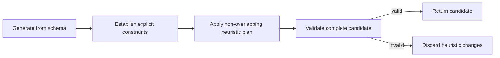

Most OpenAPI descriptions specify the shape of each field without specifying relationships between
fields. Simile can use a small provider-neutral heuristic plan to make synthesized requests and
responses more coherent when a provider has not published `x-simile-constraints`.

Heuristics are not soundness proofs. They do not reject incoming requests, change the OpenAPI
contract, or turn a likely naming convention into a service guarantee. They run only while Simile
is generating a value. The complete repaired candidate must still pass ordinary OpenAPI validation
and every explicit Simile constraint; otherwise Simile rolls the heuristic transaction back.

The distinction is practical. If a schema contains `created_at` and `updated_at` but declares no
relationship, rejecting an incoming payload where creation follows update would change the public
contract. During generation, however, placing `created_at` before `updated_at` is a useful,
reversible improvement. Explicit `x-simile-constraints` is the only way to make that ordering a
proof obligation.

## Policies

Both `simile compile` and `simile run` accept `--heuristics`:

- `off` compiles no hints;
- `conservative` admits only high-confidence conventions;
- `standard` admits high- and medium-confidence conventions and is the default;
- `aggressive` also admits deliberately narrow low-confidence conventions.

The current provider-neutral catalog recognizes compatible numeric or RFC 3339 date-time
`created_at`/`updated_at`, `start`/`end`, and `*_start`/`*_end` pairs at conservative level. Standard
also recognizes a direct plural array and matching singular `*_count` field when the object does
not look paginated. Aggressive additionally recognizes the exact
`amount_remaining = amount_due - amount_paid` naming identity.

Each compiled rule contains a stable versioned identifier, confidence, the exact field paths that
provided evidence, and a typed action. The artifact inspector reports the number of compiled
rules. The runtime therefore does not scan names or descriptions.

## Authority and suppression

An explicit `x-simile-constraints` declaration always has priority. When its selectors overlap a
potential heuristic, the compiler omits that heuristic. This prevents a weak convention from
competing with provider-authored semantics.

Description prose is not interpreted. Heuristics require exact names and compatible structural
types. Provider-specific profiles are intentionally excluded for now; adding one later requires a
separate, named source of rules rather than mixing vendor knowledge into the generic catalog.

## Generation order

Read [Payload soundness](/payload-soundness) for authoritative relationships.
