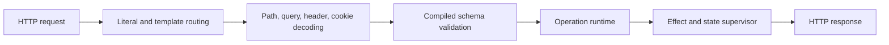

The HTTP adapter is intentionally thin. It translates wire input into the protocol-neutral service
supervisor and never reparses OpenAPI at request time.

## Route and parameter ownership

Path-item parameters and operation parameters are merged according to OpenAPI rules. An
operation-level declaration overrides the same location and name; header names compare
case-insensitively. Local parameter references are resolved at compile time.

Simile compiles parameter schemas into the same portable schema catalog used by request bodies.
The server validates required presence, scalar types, arrays, objects, patterns, bounds, and other
supported schema rules for:

- template path parameters;
- repeated and delimited query parameters;
- case-insensitive headers; and
- parsed cookie pairs.

The common OpenAPI styles are decoded without source parsing. The fidelity audit reports styles
that are valid OpenAPI but not executable by the current adapter.

## Helpful failures

A parameter failure identifies the location, public parameter name, rule, and message. If the
provider maps the public `malformed_request` cause, Simile renders that provider error; otherwise it
returns a structured diagnostic envelope. Request-body failures follow the same provider-first
policy.

Literal routes win over templates. Unknown paths return `404`, a known path with the wrong method
returns `405`, and both are decided before operation execution. Bodies are limited to 8 MiB.

Authentication semantics and non-JSON body codecs remain explicit boundaries; see
[Current boundaries](/current-boundaries).
