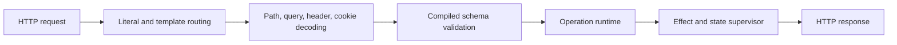

The HTTP adapter is intentionally thin. It translates wire input into the protocol-neutral service
supervisor and never reparses the source contract at request time.

## Route and parameter ownership

Source-level parameter declarations are normalized during compilation. Where OpenAPI supplies both
path-item and operation parameters, the operation-level declaration overrides the same location
and name. Header names compare case-insensitively, and local references are resolved at compile
time.

Simile compiles parameter schemas into the same portable schema catalog used by request bodies.
The server validates required presence, scalar types, arrays, objects, patterns, bounds, and other
supported schema rules for:

- template path parameters;
- repeated and delimited query parameters;
- case-insensitive headers; and
- parsed cookie pairs.

Common compiled parameter styles are decoded without source parsing. For OpenAPI contracts, the
fidelity audit reports styles that are valid OpenAPI but not executable by the current adapter.

Request bodies support JSON and structured JSON media types, form URL encoding, multipart form
data, and text media types. See [Request encoding](/request-encoding) for the complete wire mapping.

## Authentication boundary

Route matching resolves the operation before authentication runs. The adapter then evaluates the
operation's OpenAPI security alternatives against local HCL test principals. Accepted identities
continue to parameter and body validation; missing credentials return `401`, while known active
identities without required grants return `403`.

See [Authentication emulation](/authentication-emulation) for schemes, principals, grants, and
lifecycle states.

## Helpful failures

A parameter failure identifies the location, public parameter name, rule, and message. If the
provider maps the public `malformed_request` cause, Simile renders that provider error; otherwise it
returns a structured diagnostic envelope. Request-body failures follow the same provider-first
policy.

Literal routes win over templates. Unknown paths return `404`, a known path with the wrong method
returns `405`, and both are decided before operation execution. Bodies are limited to 8 MiB.

Mutual TLS remains an explicit adapter boundary because the listener has no verified client
certificate input. See [Current boundaries](/current-boundaries).
