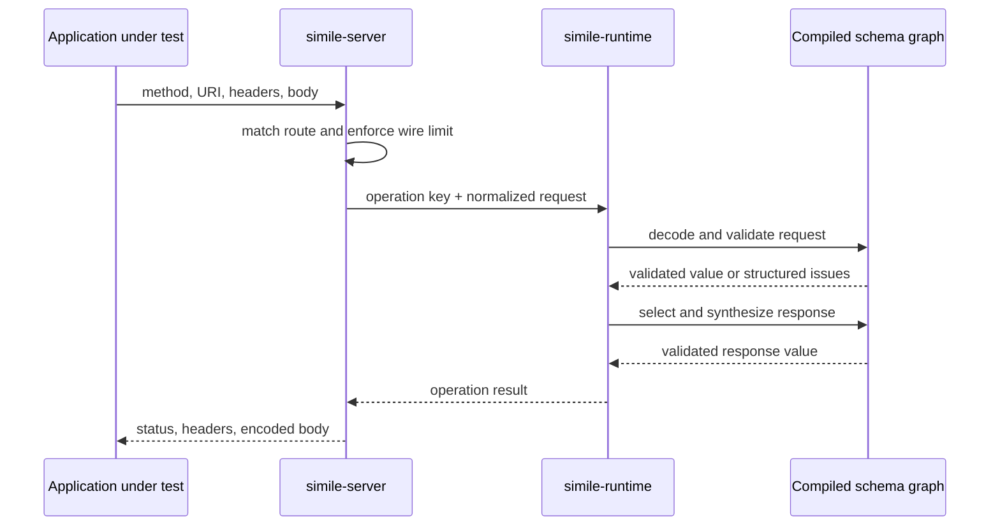

`simile-server` is intentionally thin. It translates HTTP into a protocol-neutral operation call,
then translates the runtime result back into HTTP. It does not parse OpenAPI, compile schemas,
synthesize values, or execute a provider's private infrastructure.

## Route table

At startup, the server builds a route table from validated artifact operations. Literal paths are
registered before parameter templates so a concrete route cannot be shadowed by a placeholder. The
table points to stable artifact operation keys; route handlers do not carry source-language state.

## Transport normalization

The adapter enforces an 8 MiB request-body limit, reads the declared content type, and passes the
decoded media choice to the runtime. It also normalizes replay identity:

- an `Idempotency-Key` identifies repeated mutation attempts;
- a GET request's full URI identifies repeat retrievals, including its query string.

Those identities allow deterministic replay without pretending that every operation is globally
stateful.

## Errors belong to the public contract

When request validation fails, the adapter first asks the runtime to synthesize the operation's
declared protocol error response. That keeps an emulator's error envelope faithful to the service.
Simile's own structured diagnostic—with JSON Pointer paths and named rules—is only the fallback
when the contract has no usable error response.

## Observability and lifecycle

Each completed exchange emits a concise access line containing method, path, status, origin IP,
user agent, request and response sizes, request and response media types, and elapsed time. The
listener supports graceful Ctrl-C shutdown.

The server does not own source resolution, registry paths, terminal rendering, or process policy.
Those belong to the [application layer](/application-registry). The request itself is coordinated
by [operation execution](/operation-execution).
