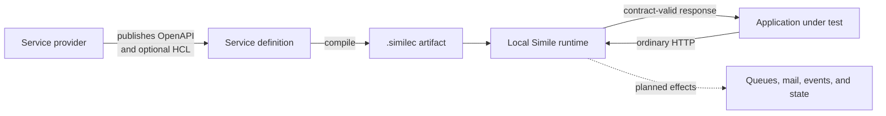

Simile turns a provider's public service contract into a local emulator. A developer can run a
service such as Inttegro on a laptop or in CI, send it normal HTTP requests, and test an
integration without depending on a shared hosted sandbox.

The important word is **service**. A useful emulator must do more than return JSON with the right
shape. It must reject invalid input, choose a result the real API is allowed to produce, preserve
relationships within the payload, replay identified calls consistently, and account for
observable work that follows the response. Simile is being designed around that complete
operation.



## The mental model

Simile separates four concerns that are often mixed together in mock servers:

1. **The public contract.** OpenAPI owns routes, request bodies, response bodies, media types,
   statuses, and public examples.
2. **Observable behavior.** Optional HCL selects declared outcomes and names effects that OpenAPI
   cannot express, without redefining the HTTP contract.
3. **Compilation.** Simile validates both sources together and emits a deterministic `.similec`
   artifact. Invalid or contradictory definitions fail before a server starts.
4. **Execution.** The runtime loads only the artifact, validates each call, chooses or synthesizes
   a response, and returns a plan for declared follow-up work.

That separation is a design decision, not an implementation detail. It keeps OpenAPI useful with
ordinary tooling, keeps private production logic out of a distributed emulator, and prevents the
runtime from reparsing provider source files on every request.

## Two ways to use Simile

### Run one operation

Use `simile run` when you want to inspect one operation, generate an example, or exercise a
contract in a script:

```bash
simile run \
  --spec-url https://example.com/openapi.yaml \
  --operation-id createOrder
```

If you omit `--request`, Simile synthesizes a request from the operation's schema and validates it
before execution. By default, stdout contains only the response payload, so the command composes
with tools such as `jq`.

### Start a service

Use `simile register` and `simile start` when an application needs a stable local HTTP endpoint:

```bash
simile register inttegro --config ./inttegro.simile.hcl
simile start inttegro
```

The configuration is intentionally small. It is a composition root, not a second API
description:

```hcl
service "inttegro" {
  listen {
    host = "127.0.0.1"
    port = 4242
  }

  openapi {
    url = "https://example.com/commerce.yml"
  }
}
```

## What to read next

- Start with [Why Simile exists](/why-simile) for the product boundary and deliberate tradeoffs.
- Follow the [Quickstart](/quickstart) to compile and run a complete local service.
- Read [OpenAPI and HCL](/openapi-and-hcl) before authoring behavior.
- Use [Service lifecycle](/service-lifecycle) to understand `register`, `update`, and `start`.
- Read [Current boundaries](/current-boundaries) before relying on fidelity that has not been
  implemented yet.

The source, issue tracker, and release history live in the
[Simile GitHub repository](https://github.com/inttegro/simile).

Install the latest release on macOS or Linux:

```bash
/bin/bash -c "$(curl -fsSL https://raw.githubusercontent.com/inttegro/simile/HEAD/install.sh)"
```
