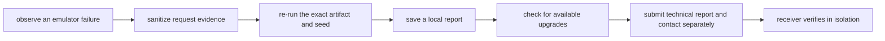

Simile can prepare a technical report when an emulator result contradicts its compiled service.
Every report carries a self-contained reproduction case. Simile runs that case before submission,
so the report begins with an observed and repeatable failure.



## Declare the destination

The service provider publishes one HTTPS destination in its `Simfile`:

```hcl
service "inttegro" {
  listen { port = 4242 }
  openapi { path = "./commerce.yml" }

  reporting {
    endpoint = "https://reports.example.com/v1/reports"
  }
}
```

This declaration makes reporting available. The person running Simile decides whether any report
may be sent and which contact address accompanies it. A provider cannot enable reporting from the
service definition.

The endpoint uses HTTPS. Loopback HTTP addresses are accepted for local receiver development.

## Choose during setup

When the service declares a destination, interactive setup offers automatic reporting after it
creates the profile:

```console
$ simile setup inttegro
...

Automatic issue reporting
Simile sends a sanitized report only after reproducing an internal emulator failure.
Destination: https://reports.example.com/v1/reports
Enable automatic reporting? [y/N]: y
Contact email for questions and fix notifications: developer@example.com
```

For CI or another non-interactive environment, make the choice explicit:

```bash
simile setup inttegro \
  --profile ci \
  --reporting automatic \
  --report-contact developer@example.com
```

Consent belongs to the service profile. Inspect or change it with:

```bash
simile reporting inttegro
simile reporting inttegro --profile ci --mode automatic --contact developer@example.com
simile reporting inttegro --profile ci --mode off
```

Contact addresses are stored in private files under `~/.simile/reporting/`. Human-readable output
masks the address. The preference also remembers the destination shown during consent. If a service
update changes that destination, run `simile reporting … --mode automatic --contact …` again to
consent to the new receiver; Simile does not silently move automatic reports elsewhere.

## What automatic reporting does

Automatic reporting watches internal emulator failures while `simile start` or `simile test` is
running. Caller errors such as malformed JSON, invalid request fields, missing authentication, and
permission failures remain ordinary API responses.

For a reportable failure, Simile:

1. keeps the exact compiled artifact, operation, seed, scenario, and fault profile;
2. removes values from fields whose names identify credentials or secrets;
3. omits non-JSON request bodies that it cannot sanitize safely;
4. runs the sanitized case locally and requires the same diagnostic;
5. ignores a duplicate of an existing report fingerprint;
6. saves the report and reproduction under `~/.simile/reports/`;
7. asks the receiver whether a newer Simile or service definition is available; and
8. submits only when the preflight returns no upgrade recommendation.

Reporting work runs outside the HTTP request path. A full reporting queue drops additional
candidates instead of consuming unbounded memory. Reporting failures appear in Simile's diagnostic
logs and never stop the emulated service.

## Prepare a report yourself

Start with a reproduction bundle that demonstrates the inconsistency:

```bash
simile run ./openapi.yaml \
  --operation-id createOrder \
  --request ./request.json \
  --seed 42 \
  --bundle ./create-order.simile-repro
```

Prepare the report:

```bash
simile report inttegro \
  --bundle ./create-order.simile-repro \
  --title "createOrder returns a different customer" \
  --description "The response customer ID should preserve request.customer_id."
```

Simile verifies the bundle before creating a report. The command prints its `rpt_…` identifier and
local directory. Review `report.json` and `case.simile-repro/` there before sending.

Send with a one-time contact address:

```bash
simile report rpt_8eaadf11a66373a4 \
  --send \
  --contact developer@example.com
```

If the report names a profile with automatic reporting enabled, its saved contact may be used:

```bash
simile report inttegro \
  --profile checkout \
  --bundle ./create-order.simile-repro \
  --title "createOrder returns a different customer" \
  --send
```

Use `simile reports` to list local reports and `simile report REPORT_ID` to inspect one.

## Upgrade preflight

A report receiver can recommend a newer Simile release or provider service definition. Simile then
marks the report `awaiting_upgrade` and prints the upgrade command. Reproduce again after upgrading;
the newer version may already contain the correction.

When the behavior must be reported against the captured version, send it explicitly:

```bash
simile report rpt_8eaadf11a66373a4 \
  --send \
  --send-current \
  --contact developer@example.com
```

## Evidence and contact boundaries

`report.json` contains technical metadata, the diagnostic, artifact digest, verification
fingerprint, and whether the reporter can be contacted. It contains no contact address.

The submission sends contact and consent as a separate `reporter` part. The receiver can keep
technical evidence and personal data under different retention and access policies. Submitted
reports initially remain pending while the receiver independently runs the attached case.

Continue with [Reproduction bundles](/reproduction-bundles) for the case format and
[Reporting endpoint](/reporting-endpoint) for the receiver protocol.
