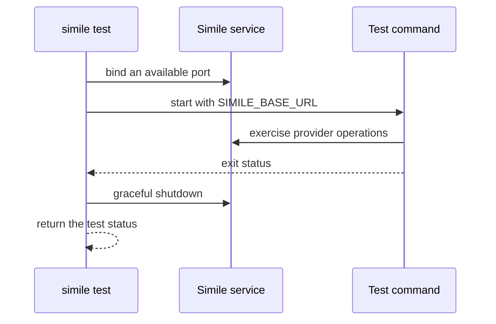

`simile test` owns the emulator for the lifetime of one test command. It binds the service first,
passes its address to the child process, waits for the child, and shuts the emulator down. The
command returns the child's exit code.

```bash
simile test -- npm test
```

This loads `./Simfile`, chooses an available loopback port, and sets `SIMILE_BASE_URL` for
`npm test`. The same pattern works with any test runner:

```bash
simile test -- go test ./...
simile test -- cargo test
simile test -- pytest
```



## Test a registered service

Name a registered service when the test project does not contain its Simfile:

```bash
simile register inttegro --config ../contracts/Simfile
simile test inttegro -- npm test
```

The registered artifact and service state are reused. `simile test` still selects an available port
for the supervised run. Pass `--port` when a test framework requires a fixed address:

```bash
simile test inttegro --port 8484 -- npm test
```

## Supply a caller profile

Set up a profile once, then inject it into the test process:

```bash
simile setup inttegro \
  --profile integration \
  --set name="Local integration"

simile test inttegro --profile integration -- npm test
```

The child receives:

- `SIMILE_BASE_URL`, containing the address bound for this run;
- `SIMILE_SERVICE`, containing the service name;
- `SIMILE_PROFILE` and `SIMILE_PRINCIPAL`; and
- every value issued by setup, using its uppercase environment name such as `API_KEY`.

When `--profile` is omitted, a registered service's current profile is used when one exists.
Simile keeps issued values out of its status output.

## Exercise controlled failures

A scenario selects one documented business case for the complete run:

```bash
simile test inttegro \
  --scenario payment_declined \
  -- npm test -- payment-declined
```

A fault profile supplies bounded environmental failures:

```bash
simile test inttegro \
  --fault-profile rough_network \
  -- npm test -- retries
```

Use a scenario when the request should reach a particular public outcome. Use a fault profile for
latency, disconnects, truncation, and related transport conditions.

## Choose the state boundary

The service state lives under `SIMILE_HOME`. A stable directory lets later runs continue from the
same resources and profiles:

```bash
export SIMILE_HOME="$PWD/.simile-local"
simile register
simile test -- npm test
```

Choose a fresh directory for an isolated test run:

```bash
SIMILE_HOME="$(mktemp -d)" simile test -- npm test
```

Keep each parallel test worker on its own `SIMILE_HOME`; a durable service database has one writer.

## Keep the service running

Use `simile start` when a developer, browser, or separately managed test process needs a stable
address:

```bash
simile start inttegro --port 8484
```

The process remains in the foreground until interrupted. See [Lifecycle](/service-lifecycle) for
registration, updates, setup, and long-running startup.
