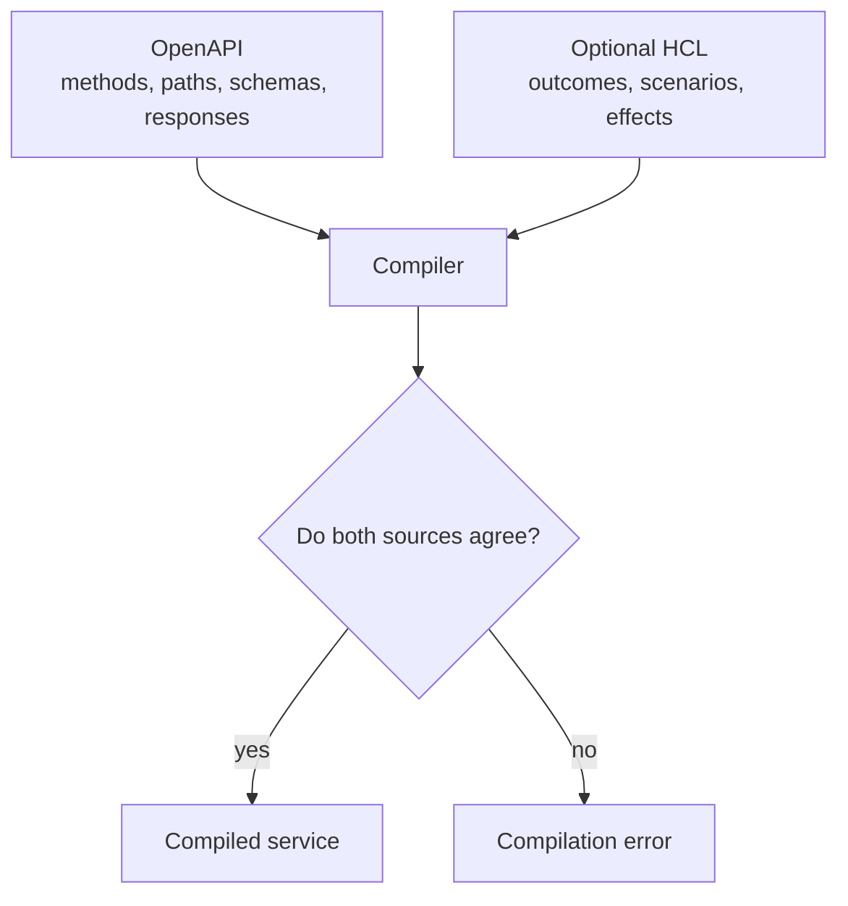

Simile accepts two provider-authored languages because they solve different problems. OpenAPI
describes the public HTTP contract. HCL describes selected observable behavior that does not belong
in that contract.

The relationship is asymmetric: OpenAPI is required and independently executable; HCL is optional
and must agree with OpenAPI.



## What OpenAPI owns

OpenAPI is the authority for:

- HTTP methods and paths;
- request body presence, media types, and schemas;
- response statuses, media types, and schemas;
- public examples and tags; and
- `operationId`, when a provider wants HCL to target an operation.

With only OpenAPI, Simile can run every normalized operation, validate a supported request body,
and synthesize a response permitted by the contract. This baseline is intentionally useful: a
provider should not have to rewrite its API before developers can emulate it.

## What HCL adds

HCL can:

- select a status already declared by the operation;
- publish exact, schema-checked named outcomes;
- select outcomes from public request values;
- group outcomes into opaque test scenarios;
- map Simile's protocol-error categories to declared service responses; and
- attach declared asynchronous work and abstract dependencies to an operation.

HCL cannot add a route, replace a request schema, invent a response status, or contradict OpenAPI.
It targets an operation by its exact `operationId`, which is why an operation needs an ID only when
HCL refers to it.

## A minimal overlay

Suppose OpenAPI already declares `POST /orders`, `operationId: createOrder`, and a `201` response.
The provider can choose that response and declare observable follow-up work:

```hcl
resource "queue" "orders" {}
resource "mail" "receipts" {}

async "dispatch_order" {
  uses = ["queue.orders", "mail.receipts"]
}

behavior "createOrder" {
  response { status = 201 }
  trigger "dispatch_order" {}
}
```

The compiler verifies that `createOrder` exists, `201` is declared, `dispatch_order` exists, and
both resource references resolve. The runtime then returns an async plan after a successful
operation. It does **not** yet execute the queue or mail resources.

## Exact outcomes without private rules

OpenAPI examples are the lowest-maintenance source of exact output. If a reusable failure family
or scenario needs more control, HCL can provide a body that is checked against the selected
OpenAPI response schema:

```hcl
error_set "payment_errors" {
  outcome "card_declined" {
    status       = 402
    content_type = "application/json"
    body = {
      error = {
        code    = "card_declined"
        message = "The payment method was declined"
      }
    }
  }
}

behavior "createPayment" {
  error_sets = ["payment_errors"]
}

scenario "payment_declined" {
  select "createPayment" {
    outcome = "card_declined"
  }
}
```

The scenario exposes the result a tester needs without embedding the provider's private decline
decision. That distinction is essential because distributed HCL is inspectable.

## Why not put everything in HCL

A second full API language would create drift. Providers would have to maintain methods, paths,
schemas, and examples twice, while ordinary OpenAPI tooling could not see the emulator's contract.
Keeping HCL additive makes source ownership clear and allows OpenAPI-only services to remain
first-class.

## Why not infer behavior from route names

`POST /orders` suggests creation to a human, but it does not prove what is stored, what identity is
assigned, or what happens later. Simile refuses to turn naming conventions into state or effect
semantics. Approximation is permitted only in bounded payload generation heuristics, where it is
reported and never becomes a validation rule.

Continue with [Outcome fidelity](/outcome-fidelity) for response selection or
[Dependencies and effects](/dependencies-and-effects) for resource declarations.
