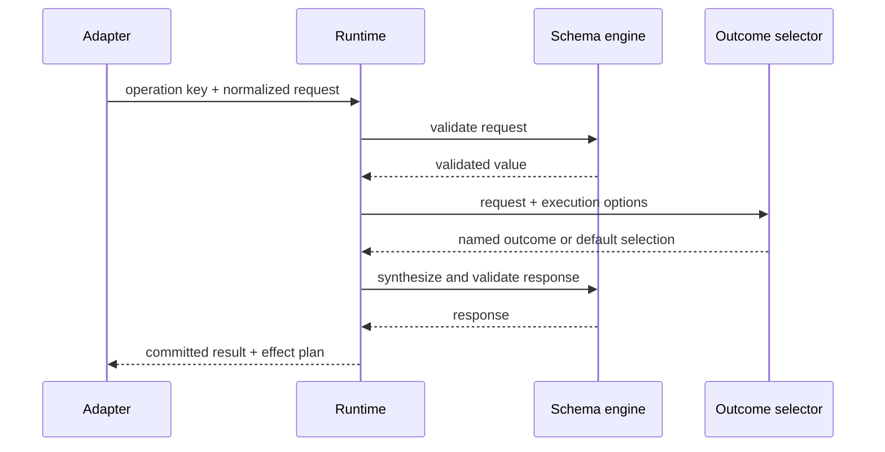

Simile executes a compiled service through a protocol-neutral runtime. The runtime does
not open a port, route a URL, or depend on an HTTP framework. It accepts the stable operation key
selected by a caller and coordinates the runtime primitives that already understand the compiled
artifact.

This boundary lets the one-shot CLI and the HTTP server share semantics without forcing HTTP
concerns into the compiler or schema engine.

## Execution boundary

`Runtime::execute` accepts an `OperationCall` containing:

- a stable operation key such as `POST /orders`;
- the incoming request Content-Type; and
- the incoming body bytes.

Transport adapters that have already decoded a body call `Runtime::execute_value` with an
`OperationValueCall`. This is the boundary used by the one-shot CLI: JSON, form, and future wire
formats remain adapter concerns while schema validation and response projection operate on one
normalized value model.

The normal execution path selects its response from the compiled contract and optional HCL
behavior. Public request predicates may select a named outcome automatically. Test scenarios that
need a particular result can use `Runtime::execute_with_options` with a named outcome or opaque
scenario; those controls are not presented as part of the incoming operation call. An adapter can
also supply an opaque `ReplayIdentity`:
`IdempotencyKey` for mutations or `Resource` for GET requests.

The runtime performs one ordered run:

1. resolve the operation from the loaded artifact;
2. decode and validate the request body;
3. synthesize the immediate response, using the validated request as context;
4. render the typed synchronous, asynchronous, and webhook occurrence plans attached to that
   committed result; and
5. cache the completed outcome when the adapter supplied a replay identity.

The result owns the validated request body, synthesized response, transport plan, and rendered
effect plan. A webhook occurrence includes its schema-checked payload, resolved destination when
available, hard dependencies, and delay. `simile-service` composes that result with Stack:
synchronous actions execute as one rollback-capable transition and checkpoint before delivery;
named asynchronous units enter the durable work outbox without blocking delivery. Background
workers lease and execute that work after the public response has committed. The HTTP handler never
applies backend commands itself.

## One-shot CLI execution

The `simile run` command compiles a local contract path or an in-memory `--spec-url` response and
invokes this runtime boundary once. Callers select the operation using either its stable
`METHOD /path` key or its exact contract operation ID. The selectors are mutually exclusive.

If the caller supplies `--request`, Simile reads an inline JSON request object, a bare file path
(`@file` remains supported), or standard input when passed `-`. The object contains a `headers`
object and an optional `body`. Header names are matched case-insensitively. `Content-Type` selects
the contract media type used to validate a provided body; the remaining headers are retained in the
execution report but are not interpreted as runtime policy. Supplying two case variants of
`Content-Type` is an error. A present JSON `null` body is distinct from an omitted body.

If any request body is declared and `--request` is absent, Simile synthesizes and validates a fresh
value from the compiled schema. This also applies to optional request bodies; only an
operation with no request-body declaration runs without one by default. `--content-type` selects a
media type for synthesis and cannot be combined with `--request`. By default, stdout is only the
pretty-printed JSON response payload; a bodyless response is `null`. Passing `--verbose` prints the
selected operation, normalized request, provided headers, and response metadata. Each invocation is a fresh process and therefore produces fresh schema-valid values; it is
not an HTTP server or a persistent replay store.

`--outcome NAME` selects one named result directly. `--scenario NAME` activates an opaque scenario
selection. They are mutually exclusive. Both controls are outside the emulated request and never
require magic provider headers.

## Replay identity

A `Runtime` owns an in-memory replay index for its lifetime. A repeated idempotency key returns the
first completed outcome, including its generated response. Reusing that key
with a different validated request is an error. A repeated `Resource` identity is accepted only for
a GET operation and returns the first outcome for that operation and resource. Different identities,
or calls without an identity, generate fresh outcomes.

The runtime deliberately does not inspect headers, route templates, or parameter names. The HTTP
adapter normalizes the idempotency header or addressed resource into `ReplayIdentity`.
This keeps HTTP policy out of the schema and operation layers, and prevents route names from being
mistaken for storage semantics.

## Attempt-scoped delivery faults

After the operation result is complete, the runtime may attach a fault activation selected by a
deterministic scenario or a bounded stochastic profile. It returns an `OperationExecution`: the
committed `OperationOutcome` plus a protocol-neutral transport plan such as respond after a delay
or disconnect after commit. Outcome selection never receives fault actions as candidate responses.

The replay index stores only `OperationOutcome`. Consequently, a disconnect after commit affects
the first delivery, while an idempotent retry returns the already committed response normally. The
HTTP adapter enacts the transport plan; the runtime never sleeps or manipulates a socket.

## Consequence supervision

HCL effects attach typed backend actions to one or more operation IDs. Inline actions are
synchronous consequences: the supervisor snapshots Stack, applies every command, checkpoints the
new snapshot, and restores the prior snapshot on command or storage failure. A replayed public
operation does not repeat those actions.

Named `async` units contain their own typed backend actions. The supervisor records them in the
durable outbox within the same checkpoint as synchronous state. Workers lease each item, execute it
outside the response-critical path, acknowledge success, and retry failure within its declared
budget. A restart restores pending work and expired leases from redb; exhausted work moves to the
dead-letter queue.

Webhook emissions are rendered from the same committed request and response. Their payload schemas,
callback body-pointer destinations, explicit destination overrides, delays, and causal edges are
therefore proven before commit. Occurrences enter the same durable outbox as async work. The
delivery worker sends the configured HTTP request, applies optional HMAC-SHA256 signing, records
causal completion, and retries unsuccessful delivery. A planned occurrence remains distinct from a
receiver acknowledgement.

## HTTP adapter

`simile-server` remains a wire adapter:

1. listen on the configured local port;
2. match the incoming method and path to a compiled operation key;
3. apply transport limits and gather the request values;
4. authenticate the request against the operation's compiled security alternatives;
5. decode and validate compiled path, query, header, cookie, and body schemas;
6. ask the service supervisor to execute the operation and synchronous effects;
7. translate the result or runtime error into an HTTP response; and
8. let the background dispatcher lease named post-response work.

It matches literal and parameterized compiled paths, applies an 8 MiB body limit, validates path,
query, header, and cookie parameters, extracts `Content-Type` and `Idempotency-Key`, and preserves GET replay
by full URI. JSON, form URL-encoded, multipart form-data, and text bodies share the same compiled
schema validation boundary. OpenAPI API key, Basic, Bearer, OAuth 2.0, and OpenID Connect schemes
resolve local HCL principals before operation execution.

For CLI usage rather than runtime internals, read [Run one operation](/run-operation). For the
current persistence model, read [State, identity, and replay](/state-and-replay). For routing,
wire limits, error adaptation, and listener lifecycle, continue to the [HTTP server](/http-server).
For deterministic and stochastic activation controls, read [Fault injection](/fault-injection).
