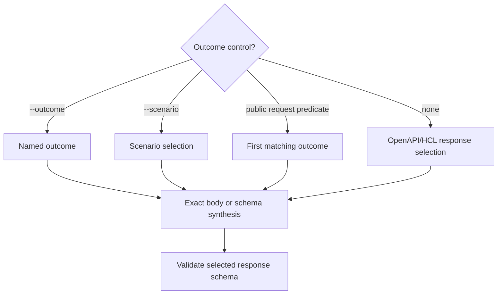

OpenAPI defines which responses are legal. Simile compiles those responses into named outcomes so
tests can select a public cause instead of asking for an arbitrary HTTP status. The resulting
catalog is carried in `.similec`; the runtime does not reopen OpenAPI or HCL.

Schema validity and behavioral fidelity are different. A synthesized `402` error may satisfy the
schema while still using meaningless generated strings. A named provider example carries stronger
evidence because its public code and message were deliberately authored. Simile records that
difference instead of presenting both as equivalent.

## Provenance

Every compiled outcome reports one fidelity source:

- `open_api_derived`: an exact OpenAPI example or fully described bodyless response;
- `provider_authored`: an HCL outcome whose body is checked against the OpenAPI response;
- `recorded_reviewed`: reserved for provider-reviewed examples produced by authoring tools;
- `schema_synthesized`: a schema-valid approximation where no exact example was published.

Scenarios are selectors, not a body-provenance source. `simile inspect` reports scenario selections
separately while the selected outcome retains the provenance of its response body.

`simile inspect service.similec` lists each operation's outcomes and calls out operations for which
every outcome is schema-synthesized. This is an authoring worklist, not a claim that those operations
are production-faithful.



## OpenAPI first

Simile derives named outcomes from response statuses, media types, and named OpenAPI examples. A
provider only needs HCL for public behavior that OpenAPI cannot express precisely. Named examples
are the lowest-maintenance way to publish exact successes and errors.

Descriptions are not executable decision trees. Simile may display them to an author, but does not
turn prose about internal checks into runtime rules.

## Reusable provider outcomes

An error family can be authored once and attached to many operations:

```hcl
error_set "payment_errors" {
  outcome "card_declined" {
    status       = 402
    content_type = "application/json"
    body = {
      error = {
        code    = "card_declined"
        message = "The payment method was declined"
      }
    }
  }
}

behavior "createPayment" {
  error_sets = ["payment_errors"]
}

apply_error_set "payment_errors" {
  tags = ["payments"]
}
```

The status must already be declared by that OpenAPI operation. The body must validate against the
selected response schema or compilation fails. `apply_error_set` attaches the family to every
operation carrying any listed OpenAPI tag, so providers can cover a product area without repeating
operation identifiers.

## Public request predicates

Simple, externally observable request values can select an outcome:

```hcl
behavior "createOrder" {
  outcome "manual_review" {
    status = 202

    when {
      path   = "/delivery/method"
      equals = "manual"
    }
  }
}
```

`path` is a JSON Pointer into the validated request body. Every `when` clause must match. These
predicates are for public contract inputs only; they must not encode private risk thresholds,
vendor decisions, database state, or production algorithms.

## Opaque scenarios

Sensitive production decisions are represented by an opaque public scenario that selects an
already declared outcome:

```hcl
scenario "payment_declined" {
  select "createPayment" {
    outcome = "card_declined"
  }
}
```

Use `simile run ... --scenario payment_declined` for one operation or
`simile start SERVICE --scenario payment_declined` for a running emulator. The distributed
artifact contains the public scenario name and observable result, never the provider's hidden
decision tree.

## Protocol errors

Simile has a small provider-neutral taxonomy for failures discovered before an operation can run:
`malformed_request`, `invalid_body`, `unsupported_media_type`, `authentication_required`,
`permission_denied`, `idempotency_conflict`, and `rate_limited`. Built-in mappings choose only a
response status already declared by the operation. A provider can override a mapping once for the
whole service:

```hcl
protocol_error "invalid_body" {
  statuses     = [422, 400]
  content_type = "application/json"
  body = {
    error = {
      code    = "invalid_body"
      message = "The request body is invalid"
    }
  }
}
```

If no compatible service response exists, the HTTP adapter retains Simile's diagnostic fallback.

## Public export audit

HCL has no construct for private implementation checks. Compilation also rejects explicit private
markers such as `_internal*`, `private_*`, `implementation_detail`, `fraud_threshold`, and
`database_table` in distributed outcome metadata. `simile inspect` reports whether the artifact
passed this audit. This is a guardrail, not a substitute for provider review of all published
examples and scenario names.

Read [OpenAPI and HCL](/openapi-and-hcl) for the source boundary and
[Current boundaries](/current-boundaries) for what an exact outcome does—and does not—prove.
