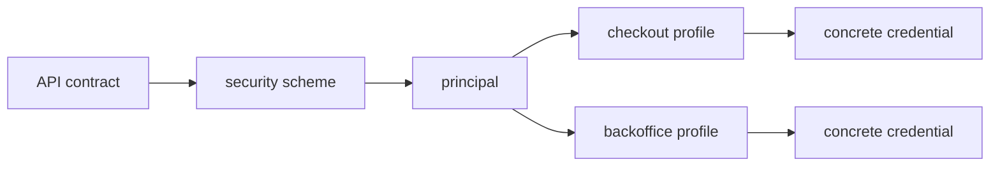
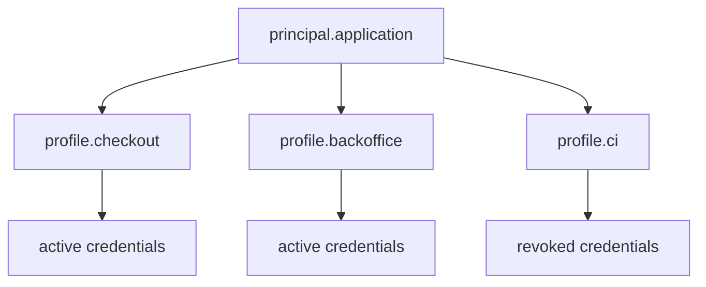

A principal describes one kind of caller recognized by a service. An Inttegro service might publish
principals for merchant applications, platform applications, and operators. Each principal gives
Simile a stable name for the caller kind and declares the credential contracts shared by every
profile of that kind.



The separation gives each concept one responsibility:

- the API contract defines authentication mechanisms and operation requirements;
- a principal defines a caller kind, its credential slots, and its grants;
- a profile supplies concrete local values for one principal;
- `principal_setup` explains how Simile provisions profiles of that principal.

## Declare a principal

The principal label becomes its service-wide name:

```hcl
principal "application" {
  description = "An application that calls the Commerce API."

  credential "merchantOAuth" {
    grants = ["orders:read", "orders:write"]
  }

  credential "secretKey" {}
}
```

`application` identifies the caller kind. `merchantOAuth` and `secretKey` refer to security schemes
published by the selected API contract. Simile verifies those references while compiling the
service.

The declaration contains no secret values. Values arrive through fixture profiles or a
`principal_setup` workflow.

## Credential contracts

Each `credential` block creates one slot on the principal:

```hcl
credential "merchantOAuth" {
  grants = ["orders:read", "orders:write"]
}
```

The label must match a contract security-scheme name exactly. The scheme controls how callers
present a value:

| Contract scheme | Request presentation | Profile value |
| --- | --- | --- |
| API key | declared header, query parameter, or cookie | `value` |
| HTTP bearer | `Authorization: Bearer …` | `value` |
| OAuth 2.0 | `Authorization: Bearer …` | `value` |
| OpenID Connect | `Authorization: Bearer …` | `value` |
| HTTP Basic | `Authorization: Basic …` | `username` and `password` |

Several slots let one principal support several authentication mechanisms. OpenAPI continues to
decide which mechanism or combination an operation accepts.

## Grants

`grants` records the scopes available through one principal credential. Consider an operation with
this OpenAPI requirement:

```yaml
security:
  - merchantOAuth: [orders:write]
```

A profile of this principal can satisfy it when it presents a matching credential:

```hcl
principal "application" {
  credential "merchantOAuth" {
    grants = ["orders:read", "orders:write"]
  }
}
```

A profile of this principal can authenticate successfully, followed by a failed authorization
check for that operation:

```hcl
principal "reporter" {
  credential "merchantOAuth" {
    grants = ["orders:read"]
  }
}
```

Simile therefore preserves the distinction between proving who the caller is and proving what the
caller may do. A missing or unrecognized credential produces `authentication_required`; an active
profile whose principal lacks a required grant produces `permission_denied`.

## Profiles instantiate principals

A profile supplies concrete values for the slots declared by its principal:

```hcl
profile "checkout_test" {
  principal = principal.application

  credential "merchantOAuth" {
    value = "sim_test_checkout"
  }
}
```

Several profiles can instantiate the same principal. They inherit its credential and grant shape
while retaining separate credentials, webhook destinations, issued identifiers, and lifecycle
states.



Fixture profiles live in the compiled service artifact. Profiles created by `simile setup` live in
the service state database. Both travel through the same authentication and authorization path.

## Provision profiles

`principal_setup` names the principal it provisions:

```hcl
principal_setup "application" {
  operation = "createApplication"

  issue "secret_key" {
    from       = response.app.secret_key
    credential = "secretKey"
    sensitive  = true
  }
}
```

When the service has one setup-enabled principal, Simile infers it and generates an unused profile
name:

```bash
simile setup inttegro
```

Services with several setup-enabled principals require `--principal`. Pass `--profile` separately
when the generated lowercase `adjective-(noun|adjective)` name should be replaced by a stable name.

## Runtime resolution

For every protected request, Simile follows the service contract in a stable order:


The resolved context carries both names. Effects and deferred webhooks can therefore retain the
concrete profile boundary while authorization remains attached to the principal contract.

Revoked and expired profiles retain their principal association, which allows deterministic tests
of credential lifecycle failures.

## Inspect the model

```bash
simile describe service inttegro
simile profiles inttegro
simile profile inttegro checkout
```

Service descriptions show principal names, credential schemes, grants, and available setup
workflows. Profile inspection shows the selected principal, status, scheme names, and local storage
paths. Secret values stay concealed in human-readable and JSON output.

Continue with [Service profiles](/service-profiles) to manage concrete identities,
[Set up a service](/service-setup) to provision them, and
[Authentication emulation](/authentication-emulation) for request matching and error behavior.
