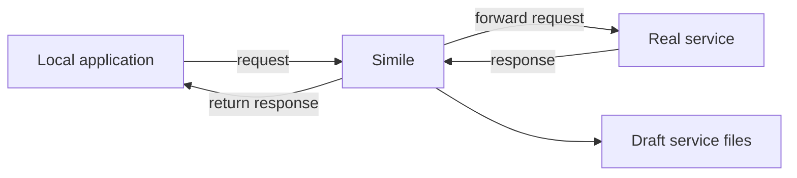

Use `simile proxy` when you need to study a real service before you emulate it.

This is useful when a provider has no OpenAPI document or Simfile. It also helps when the published
contract leaves out errors or request and response details that your integration depends on.

Your application sends API requests to Simile. Simile forwards each request to the real service and
returns the real response. Add `--learn` to record these exchanges and create a draft Simile
service.

## Start a learning session

```bash
simile proxy acme \
  --to https://api.acme.com \
  --learn
```

Simile prints a local API address, usually `http://127.0.0.1:8484`. Set your application's provider
base URL to that address.

## What happens

1. Your application calls the local Simile address.
2. Simile forwards the call to `https://api.acme.com`.
3. The real service sends its response to Simile.
4. Simile returns that response to your application.
5. Simile saves a sanitized record of the exchange.



Press Ctrl-C when you finish testing. Simile creates a draft Simfile and OpenAPI document from the
traffic it observed. Simile also checks that the draft compiles.

## What Simile can learn

From the traffic, Simile can identify:

- HTTP methods and paths;
- query parameters and media types;
- request and response shapes;
- response statuses and public errors; and
- values that repeatedly travel from a request into its response.

Some behavior never appears in a single HTTP exchange. Stored state, delayed work, retry rules, and
private decisions are common examples. Add those details to the generated `behavior.hcl` after the
learning session.

The draft improves as the evidence improves. Exercise successful calls, public errors, optional
inputs, and meaningful variations. Repeat calls when a request value should appear in the response.

## Continue

- [Proxy API calls](/proxy-api-calls) shows how to connect your application.
- [Review learned output](/proxy-learning-output) explains the files Simile creates.
- [Evidence and limits](/proxy-evidence-and-limits) explains what Simile records and what the proxy
  currently supports.
