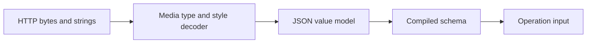

HTTP carries strings and bytes. An operation contract gives those wire values their shape. Simile
performs the same sequence for every request: decode the declared representation, validate the
decoded value, then hand a transport-neutral value to the operation runtime.



## Request bodies

The runtime selects a decoder from the request `Content-Type` and the media types declared for the
operation.

| Media type | Decoded value |
| --- | --- |
| `application/json`, `application/*+json` | object, array, scalar, or null |
| `application/x-www-form-urlencoded` | object; repeated names become arrays |
| `multipart/form-data` | object; text fields become scalars and file parts become base64 strings |
| `text/*` | string |

Form transports begin with text values. Simile consults each declared property schema before
coercing booleans or numbers, so `quantity=2` can become the integer `2` while a string such as
`postal_code=00123` keeps its leading zeros. Repeated names remain arrays and receive the same
schema-guided treatment as a unit.

One operation can publish more than one representation:

```yaml
requestBody:
  required: true
  content:
    application/json:
      schema: { $ref: '#/components/schemas/CreateCustomer' }
    application/x-www-form-urlencoded:
      schema: { $ref: '#/components/schemas/CreateCustomer' }
```

`simile run` chooses a declared representation when it synthesizes a missing request. A real HTTP
request supplies `Content-Type`; an absent or undeclared type produces a helpful protocol error.

## Parameters

OpenAPI parameter style controls how one schema value is represented outside the body. Simile
supports the styles that OpenAPI assigns to ordinary HTTP locations:

| Location | Styles |
| --- | --- |
| path | `simple`, `label`, `matrix` |
| query | `form`, `spaceDelimited`, `pipeDelimited`, `deepObject` |
| header | `simple` |
| cookie | `form` |

Examples for the same logical value:

```text
simple object:       X-Meta: region=eu,level=3
label array:         /points/.3.4.5
matrix object:       /paint/;r=100;g=200
exploded form object:?role=admin&active=true
deep object:         ?filter[role]=admin&filter[active]=true
```

Exploded form objects place their properties beside the parameter name. The decoder uses the
compiled object properties to collect only fields owned by that parameter, leaving unrelated query
or cookie values untouched.

## Failure behavior

The runtime validates each decoded parameter against the same schema engine used for bodies. A
failure reports its public name, location, message, and nested schema issues. Provider-authored
protocol errors can map the public failure while the structured Simile diagnostic remains the
fallback.

`simile audit` reports an error when a compiled parameter style has no executable decoder. This
keeps wire support explicit and prevents a plausible but incorrect approximation.

Continue with [HTTP contract surface](/http-contract), [Request validation](/request-validation),
or [Run an operation](/run-operation).
