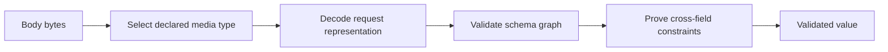

Simile validates a request from the compiled `.similec` artifact. The selected OpenAPI, Smithy, or
semantic TypeScript contract is parsed only while the provider builds that artifact; the local
runtime does not need the original contract or an HCL module.

Validation answers a narrow question: **does this decoded body satisfy every rule Simile compiled
for this operation and direction?** It does not infer business meaning from route names or prose.

## Boundary

The current runtime primitive accepts a stable operation key such as `POST /orders`, an optional
Content-Type header, and body bytes. It evaluates the request in this order:

1. locate the operation in the loaded artifact;
2. determine whether the operation declares or requires a body;
3. select the declared media type, ignoring Content-Type parameters and honoring `type/*` and
   `*/*` declarations;
4. decode the selected JSON, text, form URL-encoded, or multipart representation; and
5. validate the decoded value against the compiled schema graph.

These stages return separate errors. A missing required body is not a malformed body; an
undeclared media type is not a schema error; and malformed JSON has a source line and column.
Schema failures contain a bounded list of issues with a JSON Pointer `path`, a stable `rule`, and a
human-readable `message`.

When an operation declares a suitable client-error response, the HTTP service returns that response
instead of exposing Simile's runtime error. For example, an operation that declares a `400` error
object receives a contract-sound instance of that object when request validation fails. This keeps
the emulator's observable behavior inside the service's published contract.

If the operation declares no suitable error response, Simile falls back to its own HTTP 422
diagnostic and preserves every discovered problem under `error.issues`, for example:

```json
{
  "error": {
    "code": "invalid_body",
    "message": "request body is invalid; fix the 2 issues listed in `issues` and retry",
    "issues": [
      {
        "path": "/customer/email",
        "rule": "required",
        "message": "required property `email` is missing"
      },
      {
        "path": "/items/0/quantity",
        "rule": "minimum",
        "message": "number must be greater than or equal to 1"
      }
    ]
  }
}
```

`path` is an RFC 6901 JSON Pointer into the submitted body. Callers can use it to highlight the
corresponding input, while `rule` is a stable programmatic category and `message` explains the
specific correction. Simile also records these issues at debug level when it successfully renders a
service-declared error. Validation responses and diagnostics never echo rejected request values.

The same compiled graph can synthesize a request body. Fresh synthesis varies unconstrained values
instead of pinning every call to a published example or default. Constants and finite enums remain
within their declared choices; generated strings, numbers, booleans, identifiers, and formatted
values vary while satisfying required properties, item counts, scalar bounds, and combinators.
Synthesis is bounded, reports when it cannot find a valid finite value, and always validates the
candidate through the normal request validator before returning bytes to a caller. A caller can
supply a seed when it needs to reproduce the same generated value.

Request decoding supports JSON and `+json`, text media types, form URL encoding, and multipart form
data. File parts are represented as base64 strings before schema validation. A declared media type
without a codec produces an explicit unsupported-decoder error.

Request synthesis prefers a declared JSON media type unless the caller requests one explicitly.



## Compiled schema support

The schema compiler supports the request constraints needed for the first runtime slice:

- boolean schemas and local `#/components/schemas/...` references, including recursive schemas;
- `type`, nullability (including OpenAPI 3.0 `nullable`), `enum`, and `const`;
- `properties`, `required`, `additionalProperties`, `minProperties`, and `maxProperties`;
- `items`, `minItems`, `maxItems`, and `uniqueItems`;
- `minimum`, `maximum`, `exclusiveMinimum`, `exclusiveMaximum`, and `multipleOf`;
- `minLength` and `maxLength`; and
- `allOf`, `anyOf`, `oneOf`, and `not`;
- numeric and RFC 3339 date-time ordering declared with `x-simile-constraints`;
- conditional implications with field, membership, or path-comparison antecedents and a
  conjunctive consequence set;
- scalar equality across fields and array items, relative field bounds, numeric equations, and
  guarded collection aggregates;
- distinct selected scalar values, scalar set relationships, and recursively scoped item
  constraints; and
- derived string templates and finite acyclic lifecycle snapshots.

For request validation, a property marked `readOnly` is removed from the object's required set, as
required read-only properties apply to responses rather than requests.

Annotation keywords and unrecognized extension keywords do not affect validation. The recognized
`x-simile-constraints` extension is compiled into executable typed relationships. Validation
keywords outside the supported list are not applied in this first slice and must not be treated as
enforced. Keywords and relationships that Simile claims to support are type-checked during artifact
compilation; malformed definitions fail the build rather than weakening those compiled constraints
silently.

See [payload soundness](payload-soundness.md) for the exact proof boundary and relationship
semantics.

The validation pass caps both traversal depth and reported issue count. Those bounds protect the
runtime and keep an invalid request response useful. The HTTP server applies its body-size limit
before decoding.

Read [Payload soundness](/payload-soundness) for cross-field proofs and
[Response synthesis](/response-synthesis) for how a validated value can influence the result.
