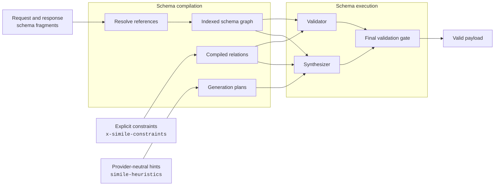
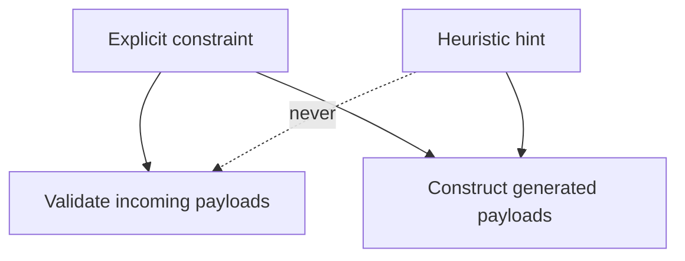

`simile-schema` compiles the executable subset of JSON Schema into an indexed graph. The graph is
used both to validate caller-supplied payloads and to synthesize candidates when no body or response
example is available.

## One compiled graph

References are resolved once per request or response direction. Recursive references remain graph
edges instead of copied trees. The compiler retains the keywords needed by the runtime and emits
bounded, structured validation issues whose locations are JSON Pointers.

The graph is embedded in `.similec`; execution never reparses the source contract or follows a
source reference.
This makes validation deterministic and keeps source-loading failures out of the request path.

## Proof and construction are different

The `soundness` module owns cross-field relation syntax, compiled relation types, proof evaluation,
and constructive witnesses. Ordering, implication, equality, equations, aggregates, distinct
selectors, scalar set relationships, templates, and lifecycle snapshots all compile into that
module. Unsupported or unconstructible relations fail compilation rather than becoming inert
annotations.

`simile-heuristics` is deliberately weaker. It infers cautious generation hints from exact field
names and compatible types. A hint can improve a generated candidate, but it cannot make an
incoming payload pass or fail. An explicit constraint suppresses an overlapping hint.

## The final gate

Synthesis is transactional: construct a candidate, apply explicit relationships and applicable
hints, then run the authoritative validator. Simile returns the value only if it satisfies the same
compiled graph used for caller input. Exhausted synthesis remains a distinct error rather than
returning a merely plausible payload.

For source-specific authoring, see the [OpenAPI](/openapi-and-hcl),
[Smithy](/smithy-contracts), and [TypeScript](/typescript-contracts) standards. For concrete proof
patterns, see [Payload soundness](/payload-soundness) and
[Generation heuristics](/generation-heuristics).
