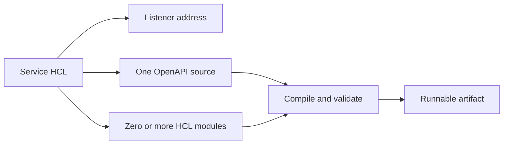

A service configuration is the composition root for one locally runnable emulator. It names the
service, selects one OpenAPI source, defines its listener, and optionally imports or contains HCL
behavior declarations. `simile register` validates and compiles the complete configuration before
installing it, while `simile start --config` retains the direct, unregistered path.

The configuration does **not** describe endpoints. OpenAPI already owns them. Think of this file as
the place where a deployable local service is assembled from independently reviewable sources.
If an agent is preparing both the contract and configuration, start with the
[service authoring prompt](/service-authoring-prompt).

```hcl
service "inttegro" {
  listen {
    host = "127.0.0.1"
    port = 4242
  }

  openapi {
    path = "./commerce.yml"
  }

  behaviors = [
    "./orders.hcl",
    "./payments.hcl",
  ]
}
```

The document must contain exactly one `service` block. Its label is the service name passed to the
CLI:

```console
$ simile register inttegro --config ./inttegro.simile.hcl
$ simile register inttegro --config https://example.com/inttegro.simile.hcl
$ simile update inttegro
$ simile update inttegro --config ./replacement.simile.hcl
$ simile update inttegro --config https://example.com/inttegro.simile.hcl
$ simile start inttegro
$ simile start inttegro --config ./inttegro.simile.hcl
$ simile start inttegro --config ./inttegro.simile.hcl --port 8484
```

`--port` has invocation precedence over `listen.port`; it does not edit the configuration.



## Local registry

The default registry root is `$HOME/.simile`; `SIMILE_HOME` overrides it for CI and tests. A
registration is an immutable runtime snapshot:

```text
~/.simile/
├── layout-version
├── services/
│   └── inttegro/
│       ├── current
│       ├── revisions/
│       │   └── REVISION/
│       │       ├── manifest.json
│       │       ├── config.hcl
│       │       └── service.similec
│       └── state/
├── locks/
└── tmp/
```

The copied HCL preserves the registered source for inspection. The versioned JSON manifest records
listener and provenance metadata. The deterministic `.similec` artifact is the runtime authority.
Consequently, starting a registered service neither depends on the original config path nor
refetches a URL-based OpenAPI source. `simile update NAME` recompiles the stored HCL after reloading
the OpenAPI and imported behavior sources it names. `simile update NAME --config URL_OR_FILE`
first replaces that HCL source. The fetched HCL is kept in the installed revision; it is not saved
as a separate download. Compilation completes before `current` advances, so a failed update leaves
the previous revision active. Existing revisions remain available for recovery, while `current` is
the only mutable pointer. `register --force` remains an explicit replacement path, but normal
refreshes should use `update`. `locks/` is reserved for cross-process coordination as registry
operations expand; `tmp/` contains only same-filesystem staging directories used before an atomic
revision install. `state/` is deliberately outside revisions so future emulated resource state can
survive a service update.

## Listener

`listen.port` is required and must be an integer from 1 through 65535. `listen.host` is optional
and defaults to the loopback address `127.0.0.1`. The host must currently be an IP address rather
than a DNS name. Binding a public interface is therefore a deliberate configuration choice, not a
CLI default.

## OpenAPI source

The `openapi` block must contain exactly one source:

```hcl
openapi { path = "./commerce.yml" }
```

or:

```hcl
openapi { url = "https://example.com/commerce.yml" }
```

A relative path is resolved from the directory containing the service configuration. A URL is read
into memory for compilation and is not saved to disk.

Both `simile register --config` and `simile update --config` can load the service configuration
itself from an HTTP or HTTPS URL. Because that document has no local directory, it must use an
OpenAPI URL and inline behavior declarations. Relative OpenAPI and imported behavior paths in a
remote configuration are rejected rather than resolved against the process working directory.

## Behavior modules

`behaviors` is an optional list of HCL module paths. Relative paths resolve from the configuration
directory. The service document may also contain the existing `resource`, `async`, and `behavior`
blocks after the `service` block:

```hcl
resource "queue" "orders" {}

async "dispatch_order" {
  uses = ["queue.orders"]
}

behavior "createOrder" {
  response { status = 201 }
  trigger "dispatch_order" {}
}
```

Resources are the portable dependencies of the emulated service. They name abstract capabilities
such as `db`, `cache`, `queue`, `mail`, `object_store`, `event_bus`, `scheduler`, or `http`, never a
production vendor. Async declarations connect observable follow-up work to those capabilities.

Imported and inline declarations enter the same semantic compiler. Duplicate declarations,
unknown OpenAPI operation IDs, undeclared resources, and contradictory response selections fail
startup before the listener binds.

## Current HTTP boundary

The server compiles OpenAPI routes into a route table and delegates matched operations to the
protocol-neutral runtime. It currently provides:

- literal and `{parameter}` path-template matching, with literal routes taking precedence;
- `404 Not Found` and `405 Method Not Allowed` responses at the transport boundary;
- an 8 MiB request-body limit;
- JSON request-body decoding and compiled-schema validation through the runtime;
- generated OpenAPI response status, media type, and body;
- named OpenAPI and HCL outcomes, including an optional process-wide `--scenario NAME`;
- service-declared protocol-error mappings for malformed or contract-invalid requests, with a
  Simile diagnostic only when the operation has no suitable error response;
- process-local replay for `Idempotency-Key` and for the full URI of GET requests; and
- one-line access logs containing method, path, status, TCP peer IP, user agent, request content type
  and size, response content type and size, and elapsed microseconds; and
- graceful shutdown on Ctrl-C.

Access logs are emitted to stderr at `info` level by default for `simile start`. Pass `--quiet` to
disable them, or use `SIMILE_LOG` to select a tracing filter explicitly. The origin is the accepted
socket's peer IP; Simile does not trust forwarding headers. Request and response bodies, query
strings, credentials, idempotency keys, and header values other than `User-Agent` are never written
to the access log.

Path, query, and header schema validation are not yet compiled into the runtime artifact. Form and
multipart codecs are also not yet implemented. HCL-declared asynchronous operations are returned
by the runtime as plans, but the server does not yet execute abstract resources or persist durable
service state. These omissions are reported here so that starting a service is not mistaken for
full behavioral fidelity.

Continue with [Service lifecycle](/service-lifecycle) to see how this file becomes a registered
revision, or [OpenAPI and HCL](/openapi-and-hcl) to decide what belongs in each source.
