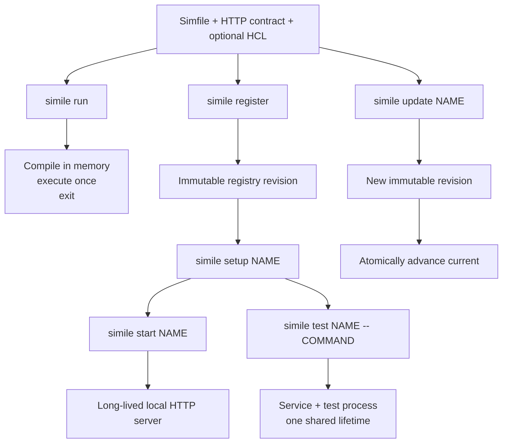

This page is the entry point for using a service definition. Most application work follows
`register` → `setup` → `test` or `start`. Contract authors can use `run` while refining one
operation, then register the complete definition when it is ready for repeated use.

| Goal | Command path |
| --- | --- |
| Try one operation | `simile run CONTRACT --operation-id ID` |
| Install a reusable service | `simile register` |
| Create local caller credentials | `simile setup SERVICE` |
| Run an application test | `simile test SERVICE -- COMMAND…` |
| Keep the emulator running | `simile start SERVICE` |
| Refresh the installed definition | `simile update SERVICE` |
| Delete the local service | `simile remove SERVICE --confirm SERVICE` |

`run` compiles and executes one operation in a short-lived process. Registered services use an
immutable compiled revision and can retain profiles, backend state, reports, and deferred work
under `SIMILE_HOME`.



## Register

```bash
simile register
```

With no arguments, registration loads `./Simfile` and uses the name declared by its `service`
block. An explicit name asserts the expected service name. `--config URL_OR_FILE` selects another
definition.

Registration performs the expensive and failure-prone work before installation:

1. load the service configuration from a local path or HTTP(S) URL;
2. resolve and load its OpenAPI, Smithy, or TypeScript source and behavior modules;
3. parse and semantically validate the selected contract language and HCL;
4. compile schemas, outcomes, constraints, and heuristic plans;
5. encode and decode the `.similec` artifact to verify it; and
6. install a private immutable revision, then atomically advance `current`.

If the service already exists, registration fails unless `--force` is explicit. Routine refreshes
should use `update` instead.

## Setup

```bash
simile setup inttegro
```

When the registered configuration declares principal setup, this command collects provisioning
values, runs its contract operation, and creates one durable profile of that principal. Issued credentials are stored
in service state and exported to a private `.env` file without appearing in command output.

Setup without `--profile` generates an unused human-readable name and creates another independent
consumer identity. Passing an existing profile name updates its collected configuration while
preserving its issued identity. See [Set up a service](/service-setup) for the authoring model.

## Start

```bash
simile start inttegro
```

Starting a registered service reads the current manifest and artifact from the registry. It does
not reopen the original configuration, read local contract files, or refetch remote sources. This
makes startup independent of the provider's availability and ensures the process runs the exact
revision that registration validated.

For an ad-hoc local run, bypass the registry:

```bash
simile start --port 8484
```

This form loads `./Simfile`. `--port` changes only that invocation. `start --config` accepts an
explicit local path; URL-based configuration loading belongs to `register` and `update`.

Override the configured listener address when a container or virtual machine must expose it:

```bash
simile start inttegro --host 0.0.0.0 --port 8484
```

## Test

```bash
simile test inttegro -- npm test
```

`test` starts the selected service on an available loopback port, supplies that address to the
child as `SIMILE_BASE_URL`, and keeps the emulator alive until the command exits. A registered
service's current profile is injected automatically; `--profile NAME` selects another profile.
Simile returns the child command's exit status and shuts the listener down.

Use `--scenario` or `--fault-profile` to run a controlled failure case. See
[Local testing](/local-testing) for the complete workflow and [CI testing](/ci-testing) for isolated
job state.

## Update

```bash
simile update inttegro
```

Update reloads the stored configuration snapshot and the sources it names, compiles a complete new
revision, and advances `current` only after success. A failed fetch, parse, semantic check, schema
compile, or artifact check leaves the active revision unchanged.

To replace the configuration source at the same time:

```bash
simile update inttegro --config https://example.com/inttegro.simile.hcl
```

An already running process keeps the artifact it loaded. Restart it to load the newly current
revision.

## Remove

```bash
simile remove inttegro --confirm inttegro
```

Removal permanently deletes the named service's complete registry directory and
`state/services/NAME.redb`. The `--confirm` value is required and must exactly match the service
name. A missing or different value fails before the registry is changed. If a running process owns
the state lock, removal fails rather than unlinking live state. Other services and the registry
layout remain intact.

Stop a running service before removal. After removal, `simile start inttegro` fails until the
service is registered again.

## Run

```bash
simile run ./openapi.yaml --operation-id createOrder
```

`run` compiles the selected contract and optional `--behavior` modules in memory, executes one
operation, prints the result, and exits. It does not read or write the service registry. Because
each invocation creates a fresh runtime, replay state does not cross CLI invocations.

## Registry layout

The default registry root is `~/.simile`; set `SIMILE_HOME` for CI isolation or tests:

```text
~/.simile/
├── layout-version
├── services/
│   └── inttegro/
│       ├── current
│       ├── revisions/
│       │   └── REVISION/
│       │       ├── config.hcl
│       │       ├── manifest.json
│       │       └── service.similec
├── state/
│   ├── services/
│   │   └── inttegro.redb
│   └── stack/
│       └── KIND/
│           └── RESOURCE_FINGERPRINT.redb
├── locks/
└── tmp/
```

The service supervisor checkpoints the complete service-owned Stack under `state/services/`.
Separately launched Stack component processes use `state/stack/`. Both use embedded redb and
sidecar ownership locks; the registry revisions themselves remain immutable. `locks/` is reserved
for broader registry coordination; installation currently relies on same-filesystem staging and
atomic rename.

## Continue

- [Set up a service](/service-setup) when the provider provisions credentials or caller settings.
- [Run one operation](/run-operation) to exercise the contract without a long-running server.
- [Local testing](/local-testing) to supervise an application test process.
- [State inspection](/state-inspection) to follow persisted resources and causal history.
- [Application and registry](/application-registry) for the installation and ownership internals.
