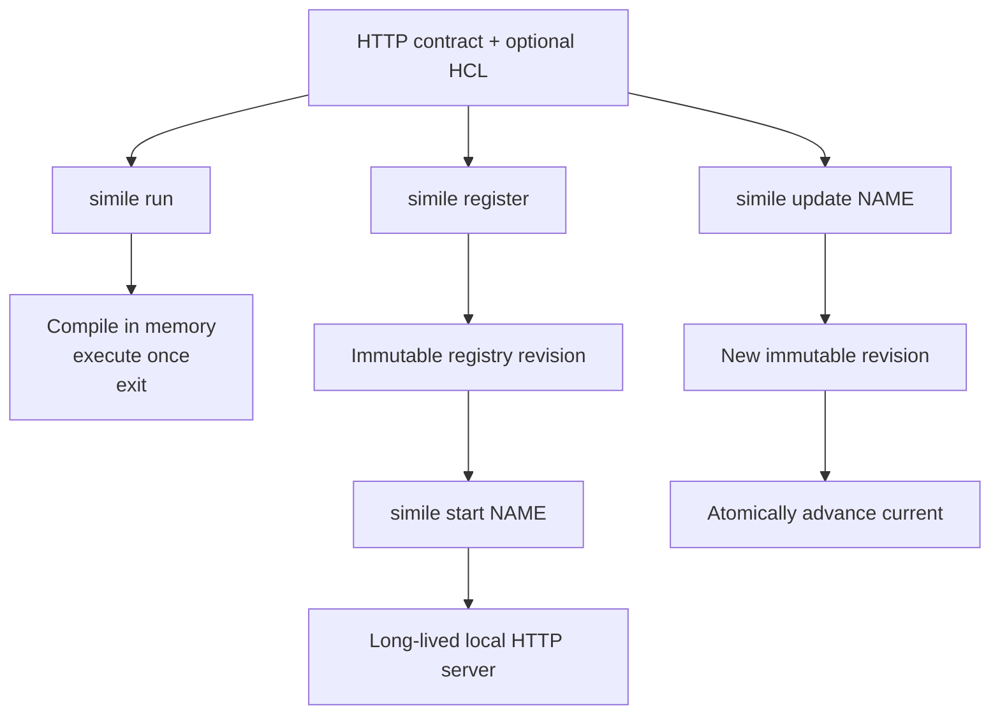

Simile has two execution paths. `run` compiles and executes one operation in a short-lived process.
`register` and `start` create a reusable local service. They share the compiler but deliberately
have different persistence and replay behavior.



## Register

```bash
simile register inttegro --config ./inttegro.simile.hcl
```

Registration performs the expensive and failure-prone work before installation:

1. load the service configuration from a local path or HTTP(S) URL;
2. resolve and load its OpenAPI, Smithy, or TypeScript source and behavior modules;
3. parse and semantically validate the selected contract language and HCL;
4. compile schemas, outcomes, constraints, and heuristic plans;
5. encode and decode the `.similec` artifact to verify it; and
6. install a private immutable revision, then atomically advance `current`.

If the service already exists, registration fails unless `--force` is explicit. Routine refreshes
should use `update` instead.

## Start

```bash
simile start inttegro
```

Starting a registered service reads the current manifest and artifact from the registry. It does
not reopen the original configuration, read local contract files, or refetch remote sources. This
makes startup independent of the provider's availability and ensures the process runs the exact
revision that registration validated.

For an ad-hoc local run, bypass the registry:

```bash
simile start inttegro --config ./inttegro.simile.hcl --port 8484
```

`--port` changes only that invocation. `start --config` currently accepts a local path; URL-based
configuration loading belongs to `register` and `update`.

## Update

```bash
simile update inttegro
```

Update reloads the stored configuration snapshot and the sources it names, compiles a complete new
revision, and advances `current` only after success. A failed fetch, parse, semantic check, schema
compile, or artifact check leaves the active revision unchanged.

To replace the configuration source at the same time:

```bash
simile update inttegro --config https://example.com/inttegro.simile.hcl
```

An already running process keeps the artifact it loaded. Restart it to load the newly current
revision.

## Remove

```bash
simile remove inttegro --confirm inttegro
```

Removal permanently deletes the named service's complete registry directory and
`state/services/NAME.redb`. The `--confirm` value is required and must exactly match the service
name. A missing or different value fails before the registry is changed. If a running process owns
the state lock, removal fails rather than unlinking live state. Other services and the registry
layout remain intact.

Stop a running service before removal. After removal, `simile start inttegro` fails until the
service is registered again.

## Run

```bash
simile run ./openapi.yaml --operation-id createOrder
```

`run` compiles the selected contract and optional `--behavior` modules in memory, executes one
operation, prints the result, and exits. It does not read or write the service registry. Because
each invocation creates a fresh runtime, replay state does not cross CLI invocations.

## Registry layout

The default registry root is `~/.simile`; set `SIMILE_HOME` for CI isolation or tests:

```text
~/.simile/
├── layout-version
├── services/
│   └── inttegro/
│       ├── current
│       ├── revisions/
│       │   └── REVISION/
│       │       ├── config.hcl
│       │       ├── manifest.json
│       │       └── service.similec
├── state/
│   ├── services/
│   │   └── inttegro.redb
│   └── stack/
│       └── KIND/
│           └── RESOURCE_FINGERPRINT.redb
├── locks/
└── tmp/
```

The service supervisor checkpoints the complete service-owned Stack under `state/services/`.
Separately launched Stack component processes use `state/stack/`. Both use embedded redb and
sidecar ownership locks; the registry revisions themselves remain immutable. `locks/` is reserved
for broader registry coordination; installation currently relies on same-filesystem staging and
atomic rename.

See [Configuration](/service-configuration) for configuration rules and
[Compiled artifact](/compiled-artifact) for what the installed runtime reads. The component
ownership and atomic installation flow are described in [Application and registry](/application-registry).
