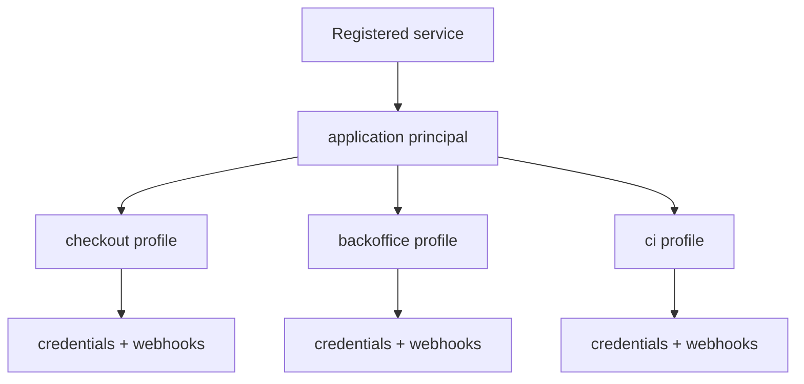

A profile is one concrete instance of a service principal. If Inttegro declares an `application`
principal, `checkout`, `backoffice`, and `ci` can each be application profiles with independent
credentials, webhook destinations, and issued identifiers.



The principal gives every profile the same credential contract. Each profile supplies the concrete
values for those credential slots. This keeps authorization policy centralized while preserving
separate caller identities. See [Principals](/principals) for the complete caller model.

## Create and list profiles

With one setup-enabled principal, Simile can infer the principal and generate a profile name:

```bash
simile setup inttegro
```

Pass `--profile` when a stable, purpose-specific name helps the team:

```bash
simile setup inttegro --profile checkout
simile setup inttegro --profile backoffice
simile setup inttegro --profile ci
simile profiles inttegro
```

```text
Profiles inttegro · 3 configured
active backoffice · application
active checkout · application · current
active ci · application
```

If the service provisions several principal kinds, select one during setup:

```bash
simile setup inttegro --principal application
simile setup inttegro --principal partner --profile settlement-partner
```

Profile names are unique within a service. That makes `simile profile inttegro checkout` and
`simile use inttegro --profile checkout` predictable without a second disambiguating argument.

## Inspect one profile

```bash
simile profile inttegro checkout
```

The report includes its principal, lifecycle status, authentication schemes, webhook configuration,
current selection, service revision, and credential-file path. Issued values remain concealed in
human and JSON output.

## Select the CLI default

```bash
simile use inttegro --profile backoffice
```

The current profile supplies a default for CLI-originated workflows. HTTP callers select a profile
by presenting its credential. Every active profile may authenticate concurrently.

## Authentication and grants

The principal defines the permitted scopes for each credential slot:

```hcl
principal "application" {
  credential "merchantOAuth" {
    grants = ["orders:read", "orders:write"]
  }
}
```

Principal setup fills the slot:

```hcl
principal_setup "application" {
  operation = "createApplication"

  issue "access_token" {
    from       = response.access_token
    credential = "merchantOAuth"
    sensitive  = true
  }
}
```

Simile authenticates the concrete token from the profile, then checks the operation's requested
scopes against the principal's credential contract. The resolved principal and profile travel with
the request into committed effects and deferred webhook delivery.

## Fixture profiles

Providers can ship synthetic profiles for deterministic authentication tests:

```hcl
profile "revoked_application" {
  description = "Exercises revoked-key handling."
  principal   = principal.application
  status      = "revoked"

  credential "secretKey" {
    value = "sim_test_revoked"
  }
}
```

Fixture profiles compile into the artifact. Setup-created profiles live in service state. Both use
the same authentication path and principal contract.

## Webhook isolation

`bind = webhook.target` stores a destination on the profile. `bind = webhook.signing_secret`
stores its signing secret. Deferred webhook work records the profile name and resolves the secret
when delivery begins; work envelopes and logs omit it.

## Storage

Profile state lives in the registered service database:

```text
~/.simile/state/services/inttegro.redb
```

Credential exports live under `~/.simile/profiles/inttegro/`. Registry updates replace the
immutable service artifact while preserving profile state. A profile records the service revision
that created it so inspection can reveal when setup should be reviewed after a contract change.

See [Principals](/principals) for caller contracts,
[Set up a service](/service-setup) for provisioning, and [Stateful services](/stateful-services) for
the broader persistence model.
