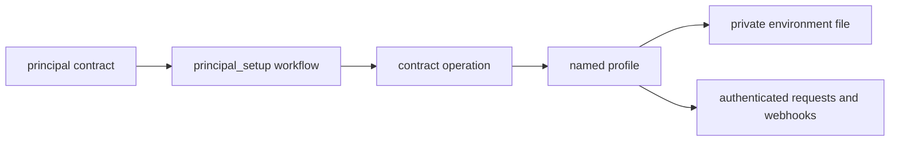

Registration installs a service definition. Setup provisions one of the caller kinds published by
that service. The result is a named profile containing the identity, credentials, webhook settings,
and other values needed by an integration.



The three nouns carry separate responsibilities:

- `principal` describes a kind of caller and the credentials it may use;
- `principal_setup` describes how Simile provisions that kind of caller;
- `profile` is one concrete local instance of the principal.

Read [Principals](/principals) for the complete caller and authorization model.

## Declare the principal

Credential permissions belong to the principal contract. The credential label names an OpenAPI
security scheme.

```hcl
principal "application" {
  description = "An application that calls the Commerce API."

  credential "merchantOAuth" {
    grants = ["orders:read", "orders:write"]
  }

  credential "secretKey" {}
}
```

## Declare principal setup

The `principal_setup` label selects the principal it provisions:

```hcl
principal_setup "application" {
  description = "Create an Inttegro application for this integration."
  operation   = "createApplication"

  collect "name" {
    description = "A name that identifies the integration."
    required    = true
    to          = request.name
  }

  collect "webhook_url" {
    description = "Where Inttegro events should be delivered."
    type        = "url"
    to          = request.webhook_url
    bind        = webhook.target
  }

  issue "app_id" {
    description = "The application identifier."
    from        = response.app.id
  }

  issue "secret_key" {
    description = "The key used to authenticate API requests."
    from        = response.app.secret_key
    credential  = "secretKey"
    sensitive   = true
  }

  issue "webhook_secret" {
    description = "The secret used to verify webhook signatures."
    generate    = "token"
    prefix      = "whsec_simile_"
    bind        = webhook.signing_secret
    sensitive   = true
  }
}
```

`operation` names an operation from the selected API contract. Simile synthesizes its smallest
valid request, places collected values at their request projections, executes a successful outcome,
and extracts the issued values. `credential` connects an issued string to one credential slot on
the principal. Permissions remain centralized on that slot.

Use `generate = "token"` when the public response omits a local-only secret. Generated tokens use
cryptographic randomness and may carry a recognizable prefix.

## Run setup

When a service declares one `principal_setup`, the principal is unambiguous:

```console
$ simile setup inttegro
name — A name that identifies the integration.: Checkout development
webhook_url (optional) — Where Inttegro events should be delivered.: http://localhost:8787/hooks
Created application profile steady-heron for inttegro
credentials /Users/me/.simile/profiles/inttegro/steady-heron.env
current yes
issued app_id, secret_key (sensitive), webhook_secret (sensitive)
```

Services with several setup-enabled principals require an explicit choice:

```bash
simile setup inttegro --principal application
```

## Profile names

When `--profile` is omitted, Simile chooses an unused two-word name from its built-in word catalog.
The first word is an adjective; the second is a noun or another adjective. Names are lowercase and
hyphenated, such as `steady-heron` or `bright-nimble`.

Pass an explicit name when scripts or teammates already refer to it:

```bash
simile setup inttegro --profile checkout
```

Explicit names also select an existing profile for reconfiguration. Generated names always resolve
to a free name, so an unnamed setup creates a new profile.

Automation can supply collected values directly:

```bash
simile setup inttegro \
  --profile ci \
  --set name="CI integration" \
  --set webhook_url=https://example.test/hooks
```

The first profile becomes current automatically. Add `--use` when a later profile should become the
CLI default.

## Reporting choice

When the service publishes a reporting endpoint, interactive setup asks whether the new profile may
send automatic emulator issue reports. The prompt shows the exact destination before asking for
consent. Choosing yes also collects an email address for clarification and fix notifications.

Automation can make the same decision explicitly:

```bash
simile setup inttegro \
  --profile ci \
  --reporting automatic \
  --report-contact developer@example.com
```

Automatic reporting covers reproducible internal emulator failures. Request validation and
authentication errors stay within the emulated API. Choosing no still permits a deliberate one-off
report later.

Use `simile reporting inttegro` to inspect profile choices and `--mode off` to withdraw automatic
reporting consent. See [Report an issue](/issue-reporting) for the complete evidence and
privacy flow.

## Credential handling

Setup output withholds issued values. Simile writes them to a private environment file:

```text
~/.simile/profiles/inttegro/checkout.env
```

On Unix, profile directories use mode `0700` and credential files use `0600`. The file includes
`SIMILE_SERVICE`, `SIMILE_PRINCIPAL`, `SIMILE_PROFILE`, `SIMILE_BASE_URL`, and one uppercase
variable per issued value.

The complete profile remains in the service's local state database so the running service can
authenticate requests and sign webhooks. Protect `~/.simile` as credential-bearing local state and
exclude it from source control and build artifacts.

## Reconfigure a profile

Run setup again with the same principal and profile name to update collected configuration such as
a webhook target. Its identity and issued credentials remain stable. Simile rejects attempts to
reuse the name for a different principal, preserving the profile's meaning.

Profile commands currently open the service state database exclusively. Stop the running service
before setup, inspection, or selection; then restart it to load the updated state.

Continue with [Principals](/principals) for caller contracts,
[Service profiles](/service-profiles) for multi-profile operation, and
[Authentication emulation](/authentication-emulation) for request matching.
