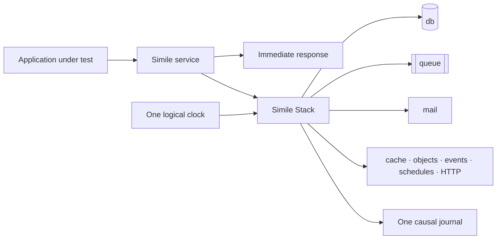

An API is rarely only HTTP. A request may write state, cache a value, publish an event, enqueue
work, send mail, schedule a retry, store a file, or call another service. Simile Stack provides
small deterministic implementations of those capabilities so a local Simile service can reproduce
the observable consequences of an operation without reproducing its production infrastructure.

## The design rule

Stack emulates **capabilities**, not vendors. `db` means durable document-like state; it does not
claim to be PostgreSQL. `queue` means delayed, at-least-once delivery with visibility and
acknowledgement; it does not claim Kafka or SQS protocol compatibility. The service definition
describes the behavior an integration can observe while private topology and vendor choices stay
private.

This keeps service definitions:

- portable across provider infrastructure changes;
- small enough for providers to author and review;
- safe to publish without disclosing internal architecture; and
- precise enough to reproduce meaningful state and asynchronous behavior.

## Components

| Capability | Process | What it emulates |
| --- | --- | --- |
| [Database](/stack-db) | `simile-db` | Versioned documents, queries, conditional writes, transactions |
| [Cache](/stack-cache) | `simile-cache` | TTLs, counters, compare-and-set |
| [Queue](/stack-queue) | `simile-queue` | Delay, visibility, acknowledgement, redelivery |
| [Mail](/stack-mail) | `simile-mail` | Accepted mail and deterministic delivery outcomes |
| [Object store](/stack-object-store) | `simile-object-store` | Bytes, metadata, ETags, conditional writes, listing |
| [Event bus](/stack-event-bus) | `simile-event-bus` | Ordered topics and independent subscriber checkpoints |
| [Scheduler](/stack-scheduler) | `simile-scheduler` | Named tasks fired by logical time |
| [Outbound HTTP](/stack-http) | `simile-http` | Expected calls, local responses, and request history |

One process hosts one capability kind and may contain several named resources. For example,
`queue.orders` and `queue.receipts` are isolated namespaces in one `simile-queue` process. This is
small enough to run locally while preserving the resource boundaries in the service definition.

## What every component shares

All components implement the same [versioned protocol](/stack-protocol), use the same
[logical-time model](/stack-time), and contribute payload-free entries to the same conceptual
[causal journal](/stack-journal). Their state is serializable, resettable, and restorable. The
supervisor owns command identity and time, so individual resources cannot disagree about when an
operation occurred.

## Execution boundary

The Stack engines and component processes are implemented. HCL already retains `async`
declarations and their abstract resource dependencies for discovery. The next integration layer
must attach provider-authored effects to operations, compile their actions into protocol commands,
and dispatch them after a successful operation.

Until that action language and dispatcher are connected, `simile start` does not automatically
launch Stack processes or turn `uses = ["queue.orders"]` into an invented queue message. The
declaration identifies authority and dependency; it does not contain enough information to infer a
command safely. See [Dependencies and effects](/dependencies-and-effects) for this boundary.

## Composition rules

Stack follows three rules that keep larger emulations understandable:

1. **State changes commit before asynchronous effects.** A response cannot claim success while its
   required state mutation remains ambiguous.
2. **Every command carries causality.** Operation, causation, correlation, and idempotency metadata
   make related activity inspectable without recording private payloads in the journal.
3. **Time is an input.** Tests advance one logical clock instead of sleeping and hoping background
   work has completed.

These rules let simple components compose into a believable service without turning Stack into a
copy of the provider's production deployment.
