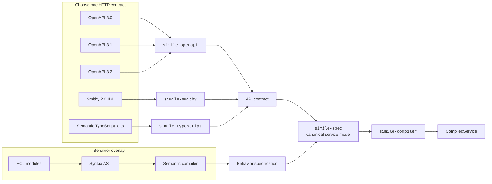

Providers publish familiar, reviewable source files. Simile accepts OpenAPI, Smithy, or semantic
TypeScript as the sole HTTP contract for one service. HCL remains an optional layer for observable
behavior the selected contract cannot express precisely.

## OpenAPI frontend

`simile-openapi` accepts JSON or YAML, detects the OpenAPI feature line, and dispatches to the 3.0,
3.1, or 3.2 adapter. Patch releases share an adapter because OpenAPI defines `major.minor` as the
feature set; Simile still preserves the exact declared version for diagnostics and reproducibility.

Each operation is normalized into a stable method/path identity plus its optional `operationId`,
parameters, request bodies, responses, and source schema fragments. An OpenAPI-only operation does
not need an `operationId`. HCL does, because it needs a published name that survives path refactors.

## Smithy frontend

`simile-smithy` parses a standalone Smithy 2.0 IDL model and lowers HTTP traits, structures,
unions, mixins, examples, and locally declared semantic traits into the same canonical contract.
Smithy mixins are flattened according to Smithy member-copy semantics before closed JSON objects
are compiled. A model can use local `simileSchema`, `simileConstraints`, `responseRelations`, and
`httpSuccessResponses` traits for public relationships that Smithy's base shape algebra cannot
state directly; the Smithy frontend consumes those traits without consulting another contract
format.

## Semantic TypeScript frontend

`simile-typescript` parses declaration files with OXC. It never invokes `tsc`, executes JavaScript,
or treats an OpenAPI-shaped object literal as the contract. Literal operation registries define the
HTTP surface; payload interfaces, unions, intersections, templates, and semantic relation types
define payload meaning. `SchemaSoundness` lowers typed cross-field relationships, while
`ResponseRelations` lowers request-to-response bindings. `Closed<T>` explicitly distinguishes a
closed public object from TypeScript's normally open structural object types.

A `.d.ts` entrypoint resolves only its relative declaration imports. A directory source loads all
non-test declaration files recursively. Unsupported unused declarations are ignored, but an
unsupported declaration referenced by the public payload graph fails compilation.

## HCL frontend

`simile-hcl` deliberately separates syntax from meaning:

1. The parser turns modules into declarations without consulting the selected contract frontend.
2. The semantic compiler resolves those declarations against the normalized API contract.

The semantic phase rejects duplicate declarations, unknown operation IDs, response statuses absent
from the contract, missing asynchronous targets, undeclared resources, invalid effect commands or
arguments, and provider-specific resource kinds. It collects declarations before resolving
references, so module order has no meaning.

## Canonical model

`simile-spec` contains the nouns shared by compilation and execution: API contracts, operations,
parameters, behaviors, effects, abstract resources, asynchronous operations, and the compiled
service. It has no YAML, HCL, file, URL, CLI, or HTTP-server concerns.

That neutrality matters. A new source frontend can target the same model, and a new runtime adapter
can consume the same artifact, without either side learning the other's syntax.

## Merge ownership

Only `simile-compiler` may combine the two sources. Every HTTP operation receives exactly one
behavior origin:

- `open_api` for behavior derived from the public contract;
- `hcl` for a validated overlay that refines that operation.

HCL is therefore additive, not a second specification of the route. Cross-source contradictions
fail compilation instead of becoming ambiguous run-time branches.

Next, follow the model through the [compilation pipeline](/compilation-pipeline) or learn how
provider extensions feed the [schema engine](/schema-engine).
