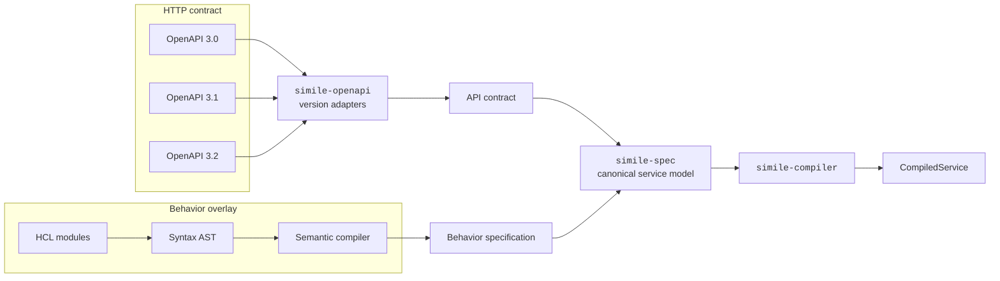

Providers publish familiar, reviewable source files. Simile does not invent a second HTTP contract:
OpenAPI describes what callers can send and receive, while HCL is an optional layer for behavior
that OpenAPI cannot express precisely.

## OpenAPI frontend

`simile-openapi` accepts JSON or YAML, detects the OpenAPI feature line, and dispatches to the 3.0,
3.1, or 3.2 adapter. Patch releases share an adapter because OpenAPI defines `major.minor` as the
feature set; Simile still preserves the exact declared version for diagnostics and reproducibility.

Each operation is normalized into a stable method/path identity plus its optional `operationId`,
parameters, request bodies, responses, and source schema fragments. An OpenAPI-only operation does
not need an `operationId`. HCL does, because it needs a published name that survives path refactors.

## HCL frontend

`simile-hcl` deliberately separates syntax from meaning:

1. The parser turns modules into declarations without consulting OpenAPI.
2. The semantic compiler resolves those declarations against the normalized API contract.

The semantic phase rejects duplicate declarations, unknown operation IDs, response statuses absent
from OpenAPI, missing asynchronous targets, undeclared resources, and provider-specific resource
kinds. It collects declarations before resolving references, so module order has no meaning.

## Canonical model

`simile-spec` contains the nouns shared by compilation and execution: API contracts, operations,
behaviors, abstract resources, asynchronous operations, and the compiled service. It has no YAML,
HCL, file, URL, CLI, or HTTP-server concerns.

That neutrality matters. A new source frontend can target the same model, and a new runtime adapter
can consume the same artifact, without either side learning the other's syntax.

## Merge ownership

Only `simile-compiler` may combine the two sources. Every HTTP operation receives exactly one
behavior origin:

- `open_api` for behavior derived from the public contract;
- `hcl` for a validated overlay that refines that operation.

HCL is therefore additive, not a second specification of the route. Cross-source contradictions
fail compilation instead of becoming ambiguous run-time branches.

Next, follow the model through the [compilation pipeline](/compilation-pipeline) or learn how
provider extensions feed the [schema engine](/schema-engine).
