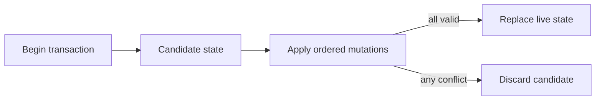

`simile-db` provides the minimum database semantics needed to make an API's state observable across
operations. It is document-oriented by design: service behavior should depend on durable values and
atomicity, not on a provider's private SQL dialect or storage topology.

## Capabilities

- `get`, `put`, `merge`, and `delete` by collection and key
- equality queries using JSON Pointer paths
- monotonically increasing document versions
- conditional writes requiring absence or an exact version
- atomic transactions containing multiple puts and deletes

A transaction executes against an isolated candidate state. If any condition fails, none of its
mutations become visible.

`put` is a complete replacement. `merge` is an upsert that recursively combines object fields,
replaces supplied scalar and array values, and leaves omitted fields unchanged. Use `merge` only
when the public operation returns or accepts a partial resource snapshot; it is not an inferred
substitute for an undeclared production update rule.

## What it does not emulate

There are no tables, joins, indexes, migrations, SQL strings, connections, or vendor error codes.
Those are implementation choices. If a public operation depends on a database-specific outcome,
model that outcome explicitly at the service contract rather than leaking the production database
into Stack.

Use versions when an integration needs believable optimistic concurrency. Use one transaction when
a service guarantee requires several state changes to succeed or fail together.
