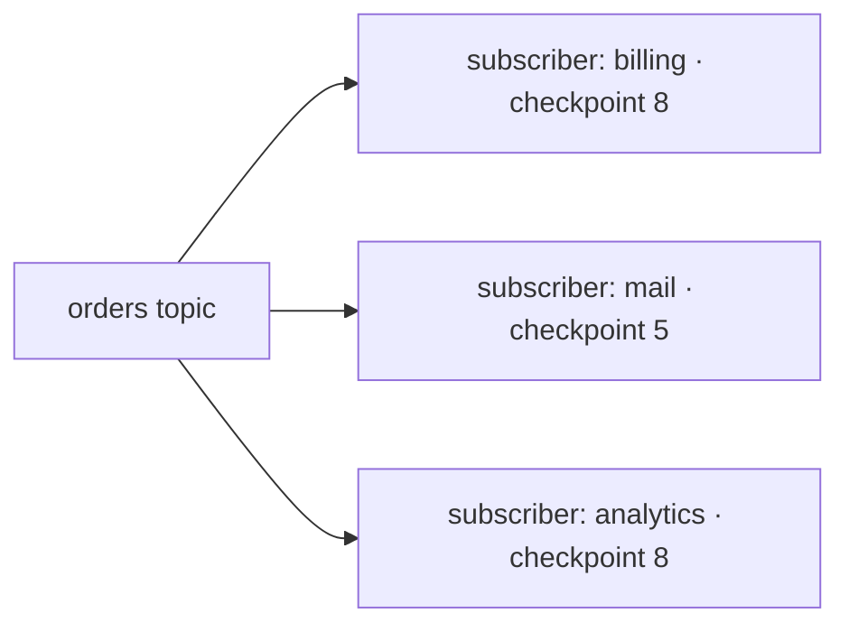

`simile-event-bus` models facts published to a topic and consumed independently by several
subscribers.

Each topic has a monotonically increasing sequence. Reading does not move a subscriber. The
subscriber commits a sequence only after it has handled the events, making replay and independent
fan-out visible.

## Capabilities

- publish an event with a JSON body and string attributes
- read events after a subscription's checkpoint
- commit a valid sequence
- inspect the current checkpoint

A commit cannot move backward or beyond the topic history. Event bodies are retained in the bus
state; cross-component journal entries remain payload-free.

Use a queue when work should be handled by one competing consumer. Use the event bus when every
subscriber needs its own view of the same ordered facts.
