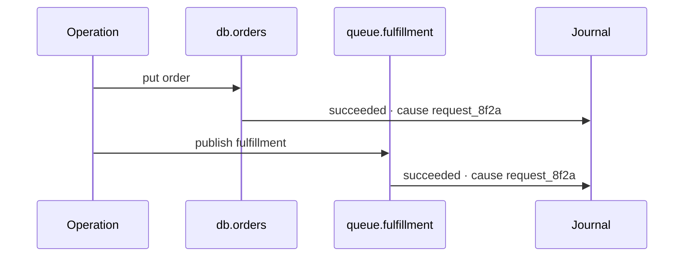

Every non-replayed resource command that passes envelope validation appends a journal entry whether
it succeeds or fails. Entries record identity, logical time, resource, action, causality, and a
stable outcome code. An idempotent replay returns the original receipt without pretending that the
resource executed twice.



## Deliberately payload-free

The journal does not copy document bodies, mail contents, queue messages, object bytes, or HTTP
credentials. Component state contains the values needed for emulation; the journal answers what
happened and why. This minimizes accidental disclosure when diagnostics are shared.

An entry includes:

- a stack-wide sequence and command identity;
- the logical timestamp;
- the resource address and action;
- optional operation, causation, and correlation identifiers; and
- `succeeded` or `failed` with a stable error code.

Queries can filter by resource, causation identifier, correlation identifier, and sequence cursor,
then apply a limit. This makes it possible to inspect direct consequences, an end-to-end trace, or
incremental activity:

```bash
simile state inttegro --caused-by request_8f2a
simile state inttegro --correlation checkout_42 --after 100
```

Stored values require a separate `--values` opt-in; see [State inspection](/state-inspection).

## Journal versus component history

Some components expose richer local history. `simile-http`, for example, records request bodies so
a test can assert an expected outbound call. That is component state and follows snapshot/reset
rules. The causal journal remains a safe cross-component index rather than a second copy of every
payload.
