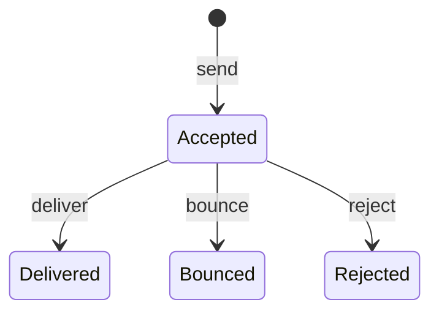

`simile-mail` accepts mail locally and makes its lifecycle inspectable. It never connects to an
external provider or sends a message to a real recipient.

## Capabilities

- accept a sender, recipients, subject, text, optional HTML, and attachments
- retrieve one message or list the local mailbox
- transition an accepted message to delivered, bounced, or rejected
- retain logical acceptance and completion timestamps

Attachments reference objects by name instead of embedding bytes. Store attachment content in
[`simile-object-store`](/stack-object-store) and place the object reference in the mail command.
This keeps command bodies small and makes the dependency explicit.

Completed messages cannot transition again. Provider webhooks, templates, reputation systems, and
SMTP details are not inferred; provider-authored behavior can schedule the public transition that
matters to the integration.
