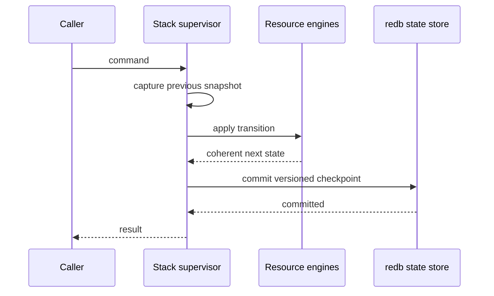

Every Stack component process automatically checkpoints state beneath Simile's home directory. No
state-path option is required:

```console
$ simile-queue \
    --listen 127.0.0.1:9402 \
    --resource fulfillment
```

The process derives a stable filename from its component kind and canonical resource set, then
opens an embedded [redb](https://www.redb.org/) database at:

```text
~/.simile/state/stack/<kind>/<resource-fingerprint>.redb
```

Set `SIMILE_HOME` to move the complete Simile home for CI isolation or another operator-controlled
location. Relative values are resolved from the current working directory, matching the service
registry. The readiness record written to stdout reports `"persistent": true`.

## Commit boundary

Persistence sits below the Stack supervisor, not inside any resource engine. Each command, logical
time advance, reset, or snapshot restore follows one transition boundary:



The caller cannot observe a successful result—or a domain failure that wrote a journal entry—until
the resulting state is durably committed. If encoding or storage fails, the supervisor restores the
complete previous in-memory snapshot and returns `unavailable`. This prevents the live process and
its state file from silently diverging.

A crash before the redb transaction commits leaves the previous checkpoint intact. A crash after
commit but before response delivery leaves the new state intact; an idempotency key lets the caller
recover the original result after restart.

## What resumes

The checkpoint contains the complete state owned by that component process:

- every named resource of its component kind;
- the logical clock and its initial reset point;
- resource contents, visibility, expiry, and delivery state;
- the causal journal and its sequence;
- command and event counters; and
- idempotency replay records.

On startup, the process restores this checkpoint before opening its listener. The component kind
and exact `--resource` declarations must match the saved state. A different resource set, Stack
protocol version, or state-format version is rejected rather than partly loaded.

When a checkpoint exists, its saved logical clock wins over `--start-time-ms`; the latter only
defines time for a new component identity.

## Ownership

One state file belongs to one running component process. Simile takes an exclusive lock using the
adjacent `<database>.lock` path and refuses a second owner. The lock file may remain on disk after
exit, but its operating-system lock is released when the process closes; its presence alone does
not mean the database is busy.

The automatic layout separates component kinds and resource sets:

```text
~/.simile/state/stack/
├── db/<fingerprint>.redb
├── mail/<fingerprint>.redb
└── queue/<fingerprint>.redb
```

Several resources of the same kind can share their component file because they share that process.

## Runtime checkpoint versus portable snapshot

The automatically managed redb file is the runtime checkpoint. The process stores one versioned
CBOR snapshot after each coherent transition. `GET /v1/snapshot` and `POST /v1/restore` remain the
portable JSON export and import surface for fixtures, inspection, and deliberate migration.

Do not copy a live redb file as an export format. Ask the owning process for its JSON snapshot, then
restore that snapshot into the destination process.

## Data and performance boundary

Unlike the [payload-free causal journal](/stack-journal), a state file contains the full emulated
documents, messages, mail, object bytes, outbound requests, and replay results held by the process.
Treat it as private test data: keep it out of source control, restrict its filesystem permissions,
and delete it when the test environment is retired.

The first persistence format favors a simple, atomic whole-Stack checkpoint over incremental tables.
That makes restart semantics easy to prove, but it also means write cost grows with component state.
It is appropriate for local and CI emulation, not a claim that Stack is a production database.
