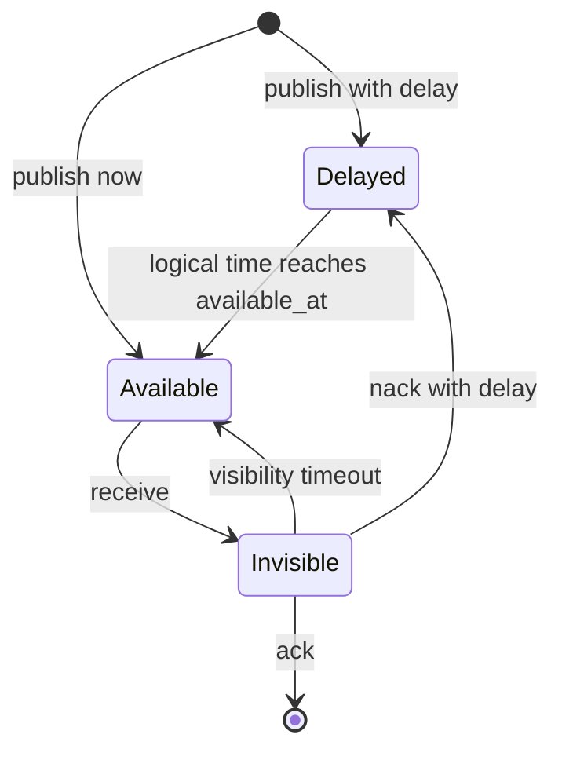

`simile-queue` provides the delivery contract most service emulations need without pretending to
be a particular broker.

## Message lifecycle

Publishing returns a deterministic message identity. Receiving assigns a new receipt handle,
increments `receive_count`, and hides the message for the requested visibility timeout. Only that
receipt can acknowledge, release, or extend the current delivery. If it is not acknowledged, the
message becomes available again and may be delivered with a different receipt.

## Capabilities

- publish now or after a logical delay
- receive a bounded batch
- acknowledge or negatively acknowledge a receipt
- extend receipt visibility
- inspect queue size

The implementation intentionally guarantees at-least-once rather than exactly-once delivery.
Idempotent consumers should therefore behave in local tests as they must in a real distributed
system.

Broker-specific partitions, consumer groups, FIFO flags, and wire protocols are outside this
capability. Independent delivery cursors belong in the [event bus](/stack-event-bus).
