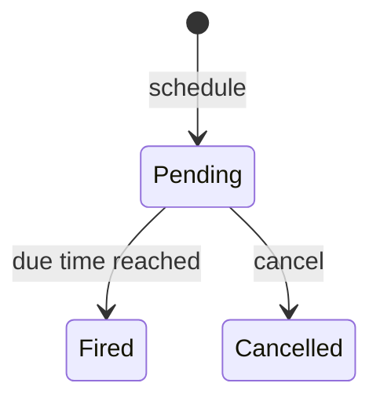

`simile-scheduler` represents deferred intent: retry this payment, expire this offer, or emit this
reminder at a known logical instant.

## Capabilities

- schedule a generated or provider-supplied task identity
- reject tasks scheduled in the past
- get or list task state
- cancel a pending task
- fire pending tasks due on or before the current logical time

Tasks move once from `pending` to either `fired` or `cancelled`. Advancing the Stack clock fires due
tasks in due-time and identity order, which makes simultaneous schedules deterministic.

Firing returns the task payload; a later dispatcher decides which service action it represents.
The scheduler does not contain cron syntax, worker code, or provider infrastructure. Repeating
schedules should compile into explicit future tasks so their behavior remains inspectable.
