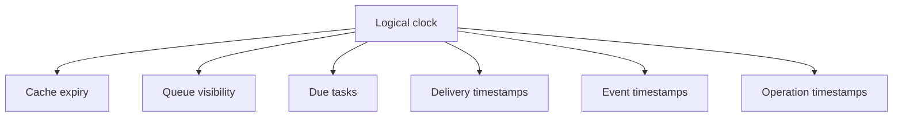

Stack has one authoritative logical timeline shared by caches, queues, schedules, mail transitions,
and journal entries. The clock remains an internal primitive so every backend observes the same
instant during one transition.

## Operation timestamps

The service captures the logical instant when it receives an operation. Response synthesis uses
that instant for server-owned event fields created by the operation:

- create operations establish `created_at` or `created`;
- mutating operations establish `updated_at` or `updated`;
- lifecycle operations establish the matching transition field, such as `archived_at`, `paid_at`,
  or `failed_at`; and
- processing fields such as `received_at`, `processed_at`, and `responded_at` describe the same
  operation instant.

The response schema chooses the representation. `format: date-time` produces RFC 3339,
`format: date` produces a calendar date, `format: unix-time` produces epoch seconds, and
`format: unix-time-ms` produces epoch milliseconds. Simile only applies this rule to fields with a
compatible explicit format.

An explicit request-to-response binding retains authority. If the caller supplies a timestamp and
the contract binds it into the response, Simile preserves the caller's value. Future instants such
as expiry or scheduled execution continue to come from request bindings, outcomes, constraints,
or schema synthesis.

## Manual mode

Manual time is the deterministic test default. Advancing 30 seconds immediately:

- expires cache entries whose TTL elapsed;
- makes delayed or previously invisible queue messages available;
- fires pending scheduler tasks due on or before the new time; and
- timestamps later commands on the new instant.

No test sleeps and no background race decides whether work is ready.

## Realtime mode

Realtime mode follows monotonic host elapsed time from a supplied starting instant. Manual advance
is rejected in this mode. It is useful for interactive local use, but manual mode is preferable for
repeatable CI assertions.

## Why the clock is shared

A separate clock service would let components observe slightly different instants or fail
independently while testing one operation. Stack instead gives every command an authoritative
`at` value and asks the supervisor to advance all resource engines together. Public configuration
describes schedules and delays, not a dependency on a clock vendor.

Snapshots retain clock mode and current logical time. Reset restores the original instant along
with empty component state.
