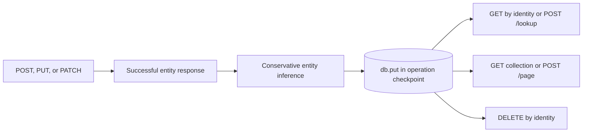

Many API contracts already contain enough public structure to describe ordinary resource state.
When a service declares one database, Simile can connect an identifiable successful response to
later reads and deletes. Providers author HCL only where public structure leaves more than one
reasonable interpretation. Besides conventional GET routes, Simile recognizes POST routes ending
in `/lookup` or `/page`, which are common in RPC-shaped HTTP APIs.



## Enable state

Declare one provider-neutral database:

```hcl
backend "db" "primary" {
  description = "Durable service records used by ordinary resource operations."
}
```

Consider this contract:

```yaml
paths:
  /products:
    post:
      operationId: createProduct
      responses:
        '201':
          content:
            application/json:
              schema: { $ref: '#/components/schemas/Product' }
    get:
      operationId: listProducts
      responses:
        '200':
          content:
            application/json:
              schema:
                type: array
                items: { $ref: '#/components/schemas/Product' }
  /products/{id}:
    get:
      operationId: getProduct
      responses:
        '200':
          content:
            application/json:
              schema: { $ref: '#/components/schemas/Product' }
        '404': { description: Missing }
    delete:
      operationId: deleteProduct
      responses:
        '204': { description: Deleted }
```

If `Product` declares an `id`, a successful create can persist the synthesized or authored product.
The later item GET reads that identity, the collection GET queries all products, and DELETE removes
the selected identity. State lives in the service's redb checkpoint under `$SIMILE_HOME`, so a
registered service can continue after restart.

For a POST `/lookup`, Simile reads an `id` or resource-shaped `*_id` scalar from the validated JSON
object. For POST `/page`, it projects stored entities into a contract-valid collection response and
repairs declared `size`, `count`, `total`, and `has_more` page metadata. It does not interpret
arbitrary POST operations as reads. An ambiguous identity or incompatible response projection
leaves the operation's ordinary authored or contract-derived outcome in control.

## Understand the inference threshold

Simile adds the default write only when all of these facts are clear:

1. exactly one `db` backend exists;
2. the operation is `POST`, `PUT`, or `PATCH` and has a stable `operationId`;
3. exactly one successful response entity has an `id` property;
4. the route yields one stable collection name; and
5. no provider-authored effect already owns the operation.

The collection comes from the semantic route segment. `/v1/products/create` becomes `products`;
version and mutation scaffolding such as `create`, `update`, and `delete` is ignored. Simile also
requires the resulting resource name to match the successful response entity. This structural
check prevents a POST action from becoming a write merely because of its method or vocabulary.
Reads accept only response shapes that the contract proves, including a direct entity, a singular
or collection wrapper, an array, `{ "data": [...] }`, and page wrappers whose collection and
metadata remain schema-valid after stored values are inserted. A possible state read whose stored
value cannot satisfy the declared response falls through to the operation's ordinary outcome.

## Take control with an effect

Custom keys, projections, multi-entity responses, or transitions across several stores deserve an
explicit effect:

```hcl
effect "persist_order" {
  description = "Store the public order under its provider reference."
  operations  = ["createOrder"]

  action "db.primary" "put" {
    collection = "orders"
    key        = response.order.reference
    value      = response.order
  }
}
```

An authored effect suppresses the inferred write for that operation. This gives the provider one
clear override rather than two competing state transitions.

## Resolve stored references during synthesis

Some valid requests identify a stored public resource instead of repeating its value. An order may
carry `price_id`, for example, while its response snapshots the resolved amount. Declare that read
inside the operation behavior:

```hcl
behavior "createOrder" {
  resolve "db.primary" {
    collection = "prices"
    key        = "/line_items/*/price_id"
    select     = "/fixed_amount"
    into       = "/line_items/*/price"
    missing_outcome = "price_not_found"

    where {
      stored  = "/product_id"
      request = "/line_items/*/product_id"
      otherwise = "invalid_line_items"
    }
  }
}
```

The stored amount exists only in the relation-synthesis view. Request validation, public outcome
matching, replay identity, and effects continue to see the exact request sent by the caller. This
separation prevents the emulator from weakening a mutually exclusive request shape merely to make
the response constructible.

`missing_outcome` selects a declared public result when the referenced document is absent.
`otherwise` on a `where` predicate selects a declared result when that public condition fails.
Leave either unset when failure indicates a broken Simfile or corrupt test state rather than a
documented service outcome.

For mutations, a stored snapshot is a baseline rather than an exact response fixture. Simile keeps
compatible stored values, constructs any newly required response fields from the schema, and then
applies the operation's declared request-to-response relation. This lets lifecycle operations add
public timestamps without erasing the resource fields already stored by an earlier request.
Server-owned creation, update, processing, and lifecycle timestamps use the Stack's shared
[logical time](/stack-time), so a stored resource records the same operation instant observed by
the causal journal and effects.

## Inspect authority

`simile audit ARTIFACT` identifies convention-inferred effects, missing state effects, and ambiguous
operations. `simile describe service NAME --verbose` labels operation refinements as
`contract_derived` or `provider_authored`. `simile state NAME --values` shows the stored engine
state when payload inspection is appropriate.

Inference represents a public convention. It carries less authority than an authored effect and
never claims knowledge of a provider's private tables or implementation.

Continue with [Dependencies and effects](/dependencies-and-effects),
[State inspection](/state-inspection), or [Stack database](/stack-db).
