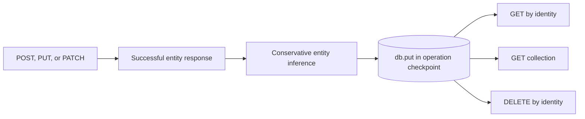

Many API contracts already contain enough public structure to describe ordinary resource state.
When a service declares one database, Simile can connect an identifiable successful response to
later reads and deletes. Providers author HCL only where public structure leaves more than one
reasonable interpretation.



## Enable state

Declare one provider-neutral database:

```hcl
backend "db" "primary" {
  description = "Durable service records used by ordinary resource operations."
}
```

Consider this contract:

```yaml
paths:
  /products:
    post:
      operationId: createProduct
      responses:
        '201':
          content:
            application/json:
              schema: { $ref: '#/components/schemas/Product' }
    get:
      operationId: listProducts
      responses:
        '200':
          content:
            application/json:
              schema:
                type: array
                items: { $ref: '#/components/schemas/Product' }
  /products/{id}:
    get:
      operationId: getProduct
      responses:
        '200':
          content:
            application/json:
              schema: { $ref: '#/components/schemas/Product' }
        '404': { description: Missing }
    delete:
      operationId: deleteProduct
      responses:
        '204': { description: Deleted }
```

If `Product` declares an `id`, a successful create can persist the synthesized or authored product.
The later item GET reads that identity, the collection GET queries all products, and DELETE removes
the selected identity. State lives in the service's redb checkpoint under `$SIMILE_HOME`, so a
registered service can continue after restart.

## Understand the inference threshold

Simile adds the default write only when all of these facts are clear:

1. exactly one `db` backend exists;
2. the operation is `POST`, `PUT`, or `PATCH` and has a stable `operationId`;
3. exactly one successful response entity has an `id` property;
4. the route yields one stable collection name; and
5. no provider-authored effect already owns the operation.

The collection comes from the semantic route segment. `/v1/products/create` becomes `products`;
route scaffolding such as version, `create`, `update`, and `delete` is ignored. Reads accept the
response shapes that the contract proves: a direct entity, a singular or collection wrapper, an
array, `{ "data": [...] }`, or a collection wrapper.

## Take control with an effect

Custom keys, projections, multi-entity responses, or transitions across several stores deserve an
explicit effect:

```hcl
effect "persist_order" {
  description = "Store the public order under its provider reference."
  operations  = ["createOrder"]

  action "db.primary" "put" {
    collection = "orders"
    key        = response.order.reference
    value      = response.order
  }
}
```

An authored effect suppresses the inferred write for that operation. This gives the provider one
clear override rather than two competing state transitions.

## Inspect authority

`simile audit ARTIFACT` identifies convention-inferred effects, missing state effects, and ambiguous
operations. `simile describe service NAME --verbose` labels operation refinements as
`contract_derived` or `provider_authored`. `simile state NAME --values` shows the stored engine
state when payload inspection is appropriate.

Inference represents a public convention. It carries less authority than an authored effect and
never claims knowledge of a provider's private tables or implementation.

Continue with [Dependencies and effects](/dependencies-and-effects),
[State inspection](/state-inspection), or [Stack database](/stack-db).
