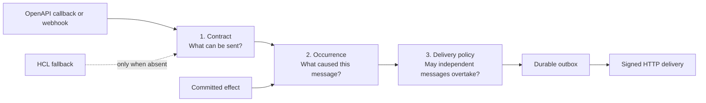

Webhook emulation spans three concerns. A service defines the message it can send, identifies the
operation result that causes the message, and describes how independent messages may be ordered.
Simile gives each decision its own layer, allowing a service provider to publish a useful contract
while protecting its private implementation. This guide is for providers who are adding webhook
behavior to a Simile service and testers who need to understand what that behavior proves. {{ className: 'lead' }}

## Prerequisites

- A service contract in OpenAPI 3.0, 3.1, or 3.2
- Stable `operationId` values for operations referenced by HCL effects
- Familiarity with [dependencies and effects](/dependencies-and-effects)
- A Simile service configuration or HCL module in which to add the examples

## Understand the three-layer model

Simile represents webhooks in three layers. Each layer answers a different question and has a
different source of authority.



1. **The webhook contract** defines the outbound HTTP method and request-body schema. OpenAPI is
   authoritative when it contains this information. A minimal HCL contract can fill a documented
   omission.
2. **The webhook occurrence** records that a committed effect caused one instance of that contract.
   It supplies the payload, destination, causal dependencies, and any explicit delay.
3. **The delivery policy** defines service-wide ordering, signing, concurrency, and retry semantics.
   It never overrides a hard causal dependency.

Each layer adds distinct meaning. A contract makes a message available; an effect establishes that
a committed operation caused an occurrence. The HCL effect then reuses the payload schema from the
public API contract.

## Define the outbound contract

Use OpenAPI for a webhook that has a published payload shape. Simile imports callbacks from
OpenAPI 3.0, 3.1, and 3.2, and imports the top-level `webhooks` map from OpenAPI 3.1 and 3.2.

### Top-level webhooks

A top-level webhook describes an event whose destination is independent of any one incoming
operation:

```yaml
openapi: 3.1.0
info:
  title: Orders
  version: 1.0.0
paths: {}
webhooks:
  order.created:
    post:
      operationId: order.created
      summary: Sent after an order is committed.
      requestBody:
        required: true
        content:
          application/json:
            schema:
              type: object
              required: [id, type]
              properties:
                id:
                  type: string
                type:
                  const: order.created
      responses:
        '204':
          description: Accepted
```

When present, the webhook operation's `operationId` is its stable Simile name. Otherwise, Simile
derives a name from the OpenAPI webhook or callback key. Use an explicit `operationId` when an HCL
effect will reference the webhook; it is clearer and survives unrelated contract reorganization.

### Callbacks

An OpenAPI callback additionally describes where the service obtains the destination. This example
reads the URL submitted in the operation body:

```yaml
openapi: 3.1.0
info:
  title: Payments
  version: 1.0.0
paths:
  /payments:
    post:
      operationId: createPayment
      requestBody:
        required: true
        content:
          application/json:
            schema:
              type: object
              required: [callback_url]
              properties:
                callback_url:
                  type: string
                  format: uri
      callbacks:
        status:
          '{$request.body#/callback_url}':
            post:
              operationId: payment.updated
              requestBody:
                required: true
                content:
                  application/json:
                    schema:
                      type: object
                      required: [id, status]
                      properties:
                        id:
                          type: string
                        status:
                          type: string
              responses:
                '204':
                  description: Accepted
      responses:
        '201':
          description: Created
```

During occurrence planning, Simile can resolve callback destinations expressed as request- or
response-body JSON pointers, including `{$request.body#/callback_url}` and
`{$response.body#/links/webhook}`. The planner currently executes body-pointer expressions. Supply
a `to` override in HCL when the destination comes from a header, query, path, or composed OpenAPI
runtime expression.

### HCL fallback contracts

When the selected API contract omits a webhook, declare the missing public message with a singular
`webhook` block:

```hcl
webhook "receipt.available" {
  content_type = "application/json"
  description  = "Sent when a downloadable receipt is ready."
  method       = "POST"
}
```

`method` defaults to `POST`, and `content_type` defaults to `application/json`. The fallback body
remains unconstrained because HCL supplies no schema. It provides naming and wire metadata.
OpenAPI adds payload proof through a reusable schema. Names imported from OpenAPI remain
authoritative and reject HCL redefinition.

## Attach occurrences to an effect

A webhook contract says what may be sent. An `effect` says that a particular committed operation
result causes it. The compact maps below let one effect emit several related occurrences:

```hcl
effect "complete_payment" {
  description = "Publish the public consequences of a completed payment."
  operations  = ["completePayment"]

  emit = {
    "payment.succeeded" = response.payment_event
    "order.paid"        = response.order_event
    "receipt.available" = response.receipt_event
  }

  after = {
    "order.paid" = ["payment.succeeded"]
  }

  delay = {
    "receipt.available" = "2s"
  }

  to = {
    "payment.succeeded" = request.callback_url
  }
}
```

The attributes have distinct responsibilities:

| Attribute | Meaning |
| --- | --- |
| `after` | Adds hard prerequisites between occurrences emitted by this effect. |
| `delay` | Schedules the occurrence independently from the immediate operation response. |
| `emit` | Maps webhook names to payload templates built from literals, `request`, `response`, or nested projections. |
| `to` | Supplies or overrides a destination using a literal or a request/response projection. |

The compiler resolves every webhook name, rejects duplicate or unknown occurrences, and rejects
self-dependencies and dependency cycles. At runtime, Simile renders each payload from the validated
request and committed response. When the contract came from OpenAPI, the rendered payload must
satisfy the webhook request-body schema before the occurrence can enter the plan.

`after` encodes a hard causal dependency. In the example, `order.paid` always follows
`payment.succeeded`. `receipt.available` is independent: its two-second delay affects its scheduled
time, and its relative delivery order remains available to the service-wide policy.

Request and response projections also act as applicability guards. If the selected error response
omits a required projection such as `response.payment_event`, Simile treats the effect as
inapplicable and preserves the public error response.

## Configure ordering and inspect the result

Webhook infrastructure commonly processes independent deliveries concurrently. Model that once at
service scope:

```hcl
webhooks {
  concurrency              = 8
  ordering                 = "best_effort"
  out_of_order_probability = 0.10
  reorder_window           = "5s"

  signing {
    secret           = "whsec_simile_local"
    header           = "X-Simile-Signature"
    timestamp_header = "X-Simile-Timestamp"
  }
}
```

These values are Simile's defaults. Their interaction is deliberate:

- `best_effort` permits an eligible independent occurrence to overtake another.
- `concurrency` is the modeled delivery capacity. Reordering requires a value of at least `2`.
- `out_of_order_probability` controls how often an otherwise eligible pair overtakes.
- `reorder_window` prevents occurrences far apart in scheduled time from being compared for
  reordering.

Simile first preserves structural guarantees. Strict policy, hard dependencies, serial delivery,
and pairs outside the reorder window all retain their original order. For an eligible pair, Simile
derives a sample from the compiled artifact fingerprint, correlation ID, and both delivery IDs.
Given those same inputs, Simile produces the same decision after restart. This is stochastic enough
to exercise realistic orderings while remaining reproducible in CI.

### Sign delivery attempts

The optional `signing` block applies one service-wide HMAC-SHA256 policy. Simile serializes the JSON
body, signs `TIMESTAMP.BODY`, and sends:

```text
X-Simile-Timestamp: 1735689600
X-Simile-Signature: t=1735689600,v1=HEX_DIGEST
```

Header names can be changed without altering the signing message. Consumers can use the timestamp
for replay-window checks and compare the digest in constant time. Use a dedicated local fixture
secret. The compiled service needs the fixture to sign deliveries, while `simile describe service`
reveals only whether signing is configured and which signature header is used.

Use strict ordering only when the emulated provider guarantees it:

```hcl
webhooks {
  ordering = "strict"
}
```

The compiler rejects strict policy combined with a non-zero reordering probability or a reorder
window. It also rejects serial best-effort configuration with a non-zero reordering probability.

Compile and inspect the artifact to confirm how many contracts and emissions it contains and which
policy was retained:

```console
$ simile compile ./commerce.yml --module ./payments.hcl --artifact ./inttegro.similec
$ simile inspect ./inttegro.similec
```

Describe a registered service to see each webhook's method, origin, public description, and the
effective service-wide policy:

```console
$ simile describe service inttegro
```

For a one-shot operation, `--verbose` includes each planned webhook's rendered body, resolved
destination when available, delay, and hard prerequisites:

```console
$ simile run ./commerce.yml --operation-id completePayment --module ./payments.hcl --verbose
```

## Delivery lifecycle

An operation commit writes every applicable occurrence to the service outbox alongside synchronous
Stack state. The worker leases a bounded batch, restores hard `after` dependencies, applies the
service ordering policy to independent occurrences, and sends each HTTP request. Any 2xx response
acknowledges the item.

Transport failures and non-2xx responses release the item with an exponential delay. A process
restart restores the outbox and retry count from redb. Exhausted deliveries move to dead-letter
storage. Hard dependencies use durable completion markers, so a later occurrence cannot cross its
prerequisite after a retry or restart. Waiting for that marker consumes no delivery attempt.
Dead letters can be returned to the outbox through the service redelivery API. A dedicated
operator-facing dead-letter CLI remains to be designed.

Local delivery proves the behavior of the compiled emulator. Production throughput, provider retry
windows, private signing rotation, and receiver acceptance remain separate evidence.

## Related resources

- [HCL language specification](/hcl-language-specification#webhook) - Exact `webhook`, `webhooks`, and `effect` syntax
- [Dependencies and effects](/dependencies-and-effects) - How operation consequences enter an effect plan
- [Durable work](/durable-work) - Checkpoint, lease, retry, and crash-recovery semantics
- [Describe a service](/describe-service) - Inspect the public meaning of a compiled service
- [Capabilities and limits](/current-boundaries) - Current webhook support and service-emulation boundaries
