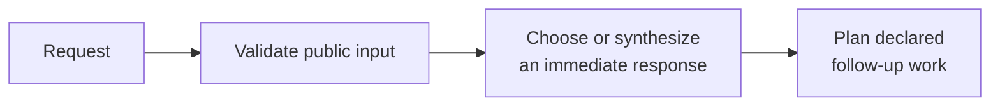

Most API testing tools make one of two compromises. A fixture server is easy to run but usually
models only request matching and static responses. A provider-hosted test mode can model more of
the real service, but the provider must operate another available, multi-tenant environment and
the developer remains dependent on it.

Simile explores a third model: the provider publishes a versioned, executable description of its
public behavior, and the developer runs that behavior locally.

## The real unit is an operation

An HTTP exchange is only the visible edge of an operation. Creating an order may return `201`,
write state, enqueue fulfillment, send a receipt, retry a webhook, and become observable through a
later `GET`. Returning a plausible order object proves very little if all of those consequences are
missing.

Simile therefore treats an operation as three related results:

The runtime validates input, produces a request-aware immediate response, commits synchronous state,
and publishes declared follow-up work durably. Background workers lease async actions and webhooks,
retry failure, and preserve causal ordering across restarts. See
[Current boundaries](/current-boundaries) for the precise fidelity of each layer.

## Who owns the truth

The provider owns what its service means. Simile owns the portable compiler and runtime. The
developer owns the machine or CI environment where that runtime executes.

This boundary matters because route names alone carry weak semantics. Simile infers ordinary CRUD
only when the public contract proves one entity, one identity, and one database authority. Custom
transitions and deterministic declines come from a public contract or an explicit,
provider-authored overlay.

## Why the definition is public

A locally runnable definition is inspectable. It must describe observable results without
shipping private fraud rules, internal thresholds, credentials, topology, or production
algorithms.

Simile supports two safe forms of control:

- a predicate over a **published request field**, when the result truly follows from public input;
- an **opaque scenario name** such as `payment_declined`, which selects a public outcome without
  revealing why production might reach it.

That is less expressive than embedding the provider's application code. The restriction is
deliberate: portability and confidentiality matter more than pretending a distributed emulator is
production.

## Design principles

### The contract remains useful on its own

Every operation in an OpenAPI, Smithy, or semantic TypeScript contract can run without HCL. Simile
validates the request and synthesizes a schema-valid response. Providers add HCL only when they
need observable behavior the selected contract cannot state. This lowers adoption cost and avoids
maintaining two competing HTTP contracts.

### Invalid definitions fail early

Unknown operation IDs, undeclared statuses, impossible constraints, missing backends, and invalid
outcome bodies fail compilation. The runtime never silently ignores a behavior declaration it
cannot execute.

### Variability is the default; identity creates replay

Independent calls should not all receive one permanent fixture. Simile generates varied valid
values. A repeated idempotency key or GET resource identity replays the first completed outcome
within the running process.

### Fidelity is reported, not implied

A provider example is stronger evidence than a schema-generated body. Simile records outcome
provenance so tooling can distinguish exact provider-authored results from contract-valid
approximations.

## Deliberate tradeoffs

Production latency, scale, undocumented behavior, infrastructure, and private decision making sit
outside the published evidence available to an emulator. Final conformance still belongs against
the real service. Simile focuses on the provider's published contract and observable scenarios,
and reports the provenance of each approximation so the user can see where evidence ends.

Continue with the [Quickstart](/quickstart), or read
[Contract sources and HCL](/contract-sources-and-hcl) for the definition model.
